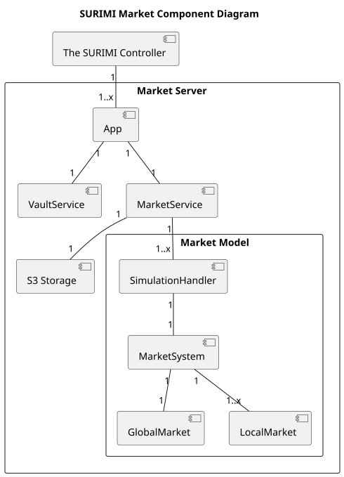
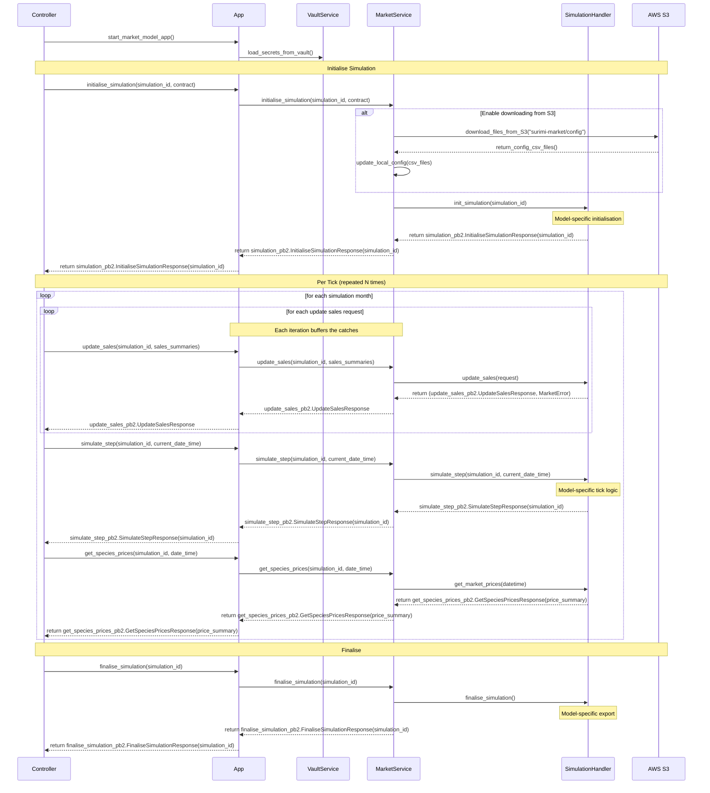
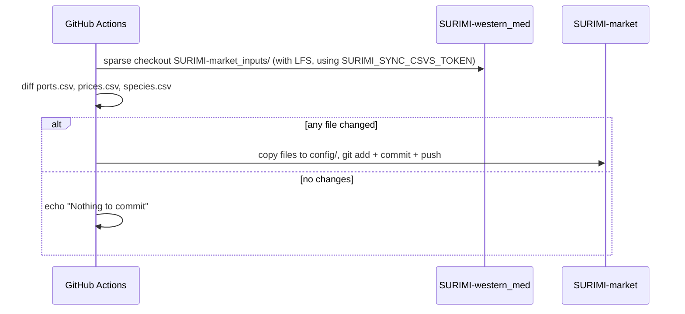

# SURIMI Market Model — Technical Documentation

---

## Table of Contents

1. [Overview](#1-overview)
2. [Architecture](#2-architecture)
3. [Simulation Lifecycle](#3-simulation-lifecycle)
4. [gRPC API](#4-grpc-api)
   - 4.1 [WorkflowService](#41-workflowservice)
   - 4.2 [MarketProviderService](#42-marketproviderservice)
5. [Data Management](#5-data-management)
   - 5.1 [Input Configuration Files](#51-input-configuration-files)
   - 5.2 [Output Files](#52-output-files)
   - 5.3 [AWS S3 Integration](#53-aws-s3-integration)
   - 5.4 [Nightly Config Sync (`SURIMI-western_med`)](#54-nightly-config-sync-surimi-western_med)
6. [Configuration & Environment Variables](#6-configuration--environment-variables)
7. [Deployment](#7-deployment)
8. [Infrastructure & Observability](#8-infrastructure--observability)

---

## 1. Overview

The **SURIMI Market Model** is a gRPC microservice framework that simulates fish market price dynamics as part of the broader **SURIMI** research project — a European initiative (2024–2027) developing socio-ecological models to support marine management strategy evaluation under the EU's **European Digital Twin of the Ocean (EU DTO)**.

The framework hosts a pluggable price model, selected at startup via the `MODEL_NAME` environment variable (see Section 6); the default is **`market`** (see `src/models/market/market_model_architecture.md`). The model answers the question *how do fish prices respond to changes in catch volume?* with its own domain model and price-formation logic; this document covers only what the framework itself provides: the gRPC surface, the simulation lifecycle's outer layers, config/data handling, deployment and infrastructure.

The service integrates into a larger simulation framework alongside other models (e.g., EwE, Poseidon, CMSY). An external workflow controller drives the simulation tick by tick, pushing catch data in and reading prices back out via gRPC.

Geographic scope: **Western Mediterranean Sea**. The exact ports, species and data range depend on the selected model's own config (see each model's own architecture doc).

---

## 2. Architecture

### Component Overview



On `Initialise`, `MarketService` first checks that the `simulation_id`
isn't already in use, then selects a model plugin via `MODEL_NAME`
(Section 6) and creates one instance of it, keyed by `simulation_id`. It
then refreshes `config/<scenario>/` from S3 if S3 credentials are
configured (Section 5.3), and finally hands the request and the config
directory path to that model instance's own initialisation. The
framework itself never reads or parses any CSV file directly — each
model reads whatever config files it needs, as documented in that
model's own architecture doc.

### Market Model Plugins

Each model plugin defines its own domain model (the classes implementing
price formation). See `src/models/market/market_model_architecture.md`.

---

## 3. Simulation Lifecycle

A simulation proceeds in three phases: **Initialise**, one or more **tick iterations**, and **Finalise**. The external controller orchestrates this sequence.

<!-- Ask third-part person for feedback on this diagram. -->

This diagram covers the framework layer only, down to each model's own
`SimulationHandler`. What happens inside that handler is model-specific —
see `src/models/market/market_model_architecture.md`.



---

## 4. gRPC API

The protocol is defined in the external [SURIMI Protocol repository](https://github.com/Official-EwE/SURIMI-protocol) and consumed as a versioned Python package from `buf.build`.

### 4.1 WorkflowService

Manages simulation lifecycle. Implemented in `server/workflow_service.py`.

| RPC | Request | Response | Description |
|---|---|---|---|
| `Initialise` | `InitialiseRequest` | `InitialiseResponse` | Creates a new simulation instance. Downloads config from S3, then hands off to the selected model's own initialisation. Fails if `simulation_id` already exists. |
| `SimulateStep` | `SimulateStepRequest` | `SimulateStepResponse` | Executes one monthly tick via the selected model. |
| `Finalise` | `FinaliseRequest` | `FinaliseResponse` | Exports the selected model's result files, then uploads the simulation directory to S3. |
| `Cancel` | `CancelRequest` | `CancelResponse` | Removes the simulation from the active dictionary without writing results. |
| `GetProtocolVersion` | `GetProtocolVersionRequest` | `GetProtocolVersionResponse` | Returns the git commit hash of the installed protobuf SDK package (derived from the package version string). |

### 4.2 MarketProviderService

Handles per-tick data exchange. Implemented in `server/market_provider_service.py`.

| RPC | Request | Response | Description |
|---|---|---|---|
| `GetSpeciesPrices` | `GetSpeciesPricesRequest` | `GetSpeciesPricesResponse` | Returns current prices for all (species, market) combinations that have a valid price. Skips combinations where price is `None`. |
| `UpdateSales` | `UpdateSalesRequest` | `UpdateSalesResponse` | Receives catch data (sales summaries with species, market, category, and quantity) and forwards it to the selected model, which buffers it until consumed on the next `SimulateStep` call. May be called multiple times per tick. |

Both services share a `simulation_dictionary: dict[str, SimulationHandler]` injected at startup. All RPCs return `INVALID_ARGUMENT` if the `simulation_id` is unknown.

---

## 5. Data Management

### 5.1 Input Configuration Files

Config files live in `config/` and are synced nightly from `SURIMI-western_med` (see Section 5.4). The exact files and columns a given model expects are documented in that model's own architecture doc (`src/models/market/market_model_architecture.md`).

On `Initialise`, the global `config/` directory is copied to `simulations/<simulation_id>/config/` to snapshot the inputs at the time of the run.

### 5.2 Output Files

Each model writes its own result files under `simulations/<simulation_id>/` on `Finalise` — see that model's own architecture doc for the exact files and columns.

### 5.3 AWS S3 Integration

Implemented in `server/s3_storage.py`. AWS credentials are injected via environment variables loaded from Vault (see Section 8).

| Event | Direction | S3 path |
|---|---|---|
| `Initialise` | Download | `surimi-market/config/` → `config/` |
| `Finalise` | Upload | `simulations/<id>/` → `surimi-market/simulations/<id>/` |

`.bin` files are skipped on upload. `.keep` files and S3 directory entries are skipped on download. If `AWS_BUCKET_NAME` or `AWS_ACCESS_KEY_ID` are not set, the operation is silently skipped.

### 5.4 Nightly Config Sync (`SURIMI-western_med`)

`SURIMI-western_med` is the separate repository that maintains the
reference data for the North-western Mediterranean scenario (ports,
species, and historical prices). A scheduled GitHub Actions workflow,
defined in `.github/workflows/sync-market-inputs.yml`, keeps this repo's
own `config/` directory in sync with it: it runs at **02:00 UTC** every
day (also triggerable manually), diffs the three CSVs against what's
already in `config/`, and commits any changes it finds.



The Personal Access Token (`SURIMI_SYNC_CSVS_TOKEN`) expires **2027-02-12**.

---

## 6. Configuration & Environment Variables

| Variable | Required | Default | Description |
|---|---|---|---|
| **Model selection** | | | |
| `MODEL_NAME` | No | `market` | Selects which model plugin handles the simulation, via `src/server/model_router.py`. |
| **gRPC** | | | |
| `GRPC_HOST` | No | `[::]` | Bind address for the gRPC server |
| `GRPC_PORT` | No | `5001` | Listening port |
| **HashiCorp Vault** | | | |
| `VAULT_ADDR` | Yes (prod) | — | Vault server URL |
| `VAULT_TOKEN` | Yes (prod) | — | Authentication token |
| `VAULT_TOP_DIR` | Yes (prod) | — | Top-level path in Vault KV store |
| `VAULT_RELATIVE_PATH` | Yes (prod) | — | Relative secret path under `VAULT_TOP_DIR` |
| `VAULT_MOUNT` | Yes (prod) | — | KV mount point |
| **AWS S3** | | | |
| `AWS_BUCKET_NAME` | Yes (prod) | — | S3 bucket name |
| `AWS_ACCESS_KEY_ID` | Yes (prod) | — | AWS access key (loaded from Vault) |
| `AWS_SECRET_ACCESS_KEY` | Yes (prod) | — | AWS secret key (loaded from Vault) |
| `AWS_SESSION_TOKEN` | No | — | Temporary session token (if using STS) |
| `AWS_DEFAULT_REGION` | Yes (prod) | — | AWS region |
| `AWS_S3_ENDPOINT` | Yes (prod) | — | S3 endpoint hostname (without `https://`) |
| **OpenTelemetry** | | | |
| `OTEL_EXPORTER_OTLP_ENDPOINT` | No | `http://localhost:4317` | OTLP collector endpoint |
| `OTEL_SERVICE_NAME` | No | `market` | Service name reported to the collector |

Vault and AWS variables can be provided via a `.env` file (not committed to the repository). If all Vault variables are absent, Vault loading is silently skipped; if AWS variables are absent, S3 operations are silently skipped.

---

## 7. Deployment

### Docker

The service ships as a single Docker image built from `python:3.12-slim`.

```dockerfile
# Build
docker build -t surimi-market .

# Run (minimal, no Vault/S3)
docker run -p 5001:5001 surimi-market

# Run with credentials
docker run -p 5001:5001 \
  -e VAULT_ADDR=... \
  -e VAULT_TOKEN=... \
  ... \
  surimi-market
```

The container exposes port `5001`. The entrypoint is `python -u src/app.py` (`-u` ensures stdout/stderr are unbuffered for immediate log visibility).

### Local Development

```bash
python -m venv .venv
source .venv/bin/activate   # Windows: .venv\Scripts\activate
pip install -r requirements.txt

# Create .env with Vault credentials (optional — service runs without S3/Vault in dev)
python src/app.py
```

### Dependency Note

The gRPC Python SDK (`surimi-surimi-protocol-grpc-python`) is pinned to a specific build from `buf.build`. Newer versions of `grpcio` can introduce OpenTelemetry / protobuf conflicts in Docker builds — update dependencies cautiously and test inside Docker before releasing.

---

## 8. Infrastructure & Observability

### HashiCorp Vault (`server/vault_service.py`)

On startup, `VaultService.LoadVaultSecretsInEnvironmentVariables()` authenticates to Vault using `VAULT_TOKEN` and reads all key-value pairs from the configured secret path into the process environment. This is the primary mechanism for injecting AWS credentials in production without storing them in the image or the repository.

### OpenTelemetry

The service exports traces and metrics to an OTLP collector (default: `localhost:4317`). This is configured via the `OTEL_EXPORTER_OTLP_ENDPOINT` and `OTEL_SERVICE_NAME` environment variables, which are set in the Dockerfile and can be overridden at runtime.

### Logging (`logger.py`)

All modules use a shared logger factory (`get_logger(name)`). Each logger writes to two sinks simultaneously:

| Sink | Location | Level |
|---|---|---|
| Console (stdout) | — | `DEBUG` |
| Rotating file | `logs/surimi.log` | `DEBUG` |

Log format: `YYYY-MM-DD HH:MM:SS LEVEL    logger_name - message`

The `logs/` directory is created automatically on first run and is excluded from git.
