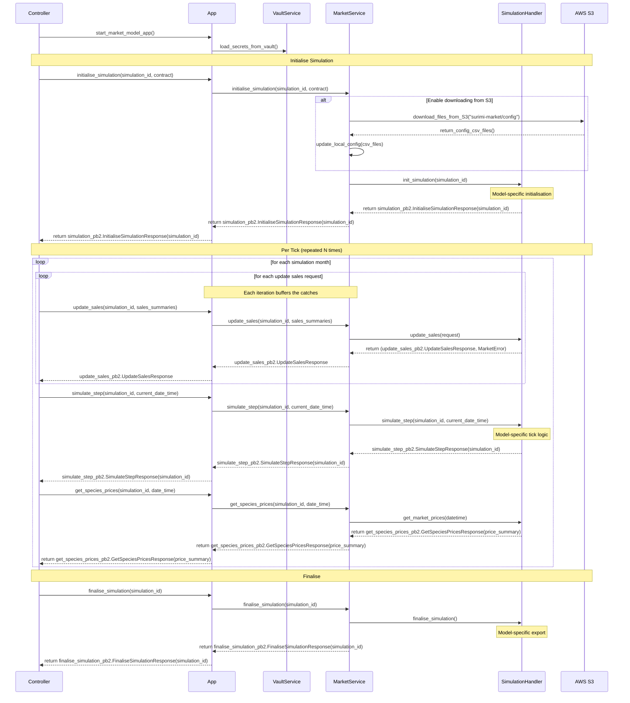

# SURIMI Market Model — Technical Documentation

---

## Table of Contents

1. [Overview](#1-overview)
2. [Architecture](#2-architecture)
3. [Simulation Lifecycle](#3-simulation-lifecycle)
4. [gRPC API](#4-grpc-api)
   - 4.1 [MarketService](#41-marketservice)
5. [Data Management](#5-data-management)
   - 5.1 [Input Configuration Files](#51-input-configuration-files)
   - 5.2 [Output Files](#52-output-files)
   - 5.3 [AWS S3 Integration](#53-aws-s3-integration)
6. [Configuration & Environment Variables](#6-configuration--environment-variables)
8. [Infrastructure & Observability](#7-infrastructure--observability)

---

## 1. Overview

The **SURIMI Market Model** is a gRPC microservice framework that simulates fish market price dynamics as part of the broader **SURIMI** research project — a European initiative (2024–2027) developing socio-ecological models to support marine management strategy evaluation under the EU's **European Digital Twin of the Ocean (EU DTO)**.

The framework hosts a pluggable price model, selected at startup via the `MODEL_NAME` environment variable (see Section 6); the default is **`market`** (see `src/models/market/market_model_architecture.md`). The model answers the question *how do fish prices respond to changes in catch volume?* with its own domain model and price-formation logic; this document covers only what the framework itself provides: the gRPC surface, the simulation lifecycle's outer layers, config/data handling, deployment and infrastructure.

The service integrates into a larger simulation framework alongside other models (e.g., EwE, Poseidon, CMSY). An external workflow controller drives the simulation tick by tick, pushing catch data in and reading prices back out via gRPC.

Geographic scope: **North-Western Mediterranean Sea**. The exact ports, species and data range depend on the selected model's own config (see each model's own architecture doc).

---

## 2. Architecture

### Component Overview
The **SURIMI Market Model** as a framework consists of a core, which is the backend that handles configurations, networking, routing and other essential activities to provide a scalable and robust runtime environment for pluggable models. From the SURIMI Controller's perspective, this framework's runtime is a gRPC service. Each of the framework's components have the following responsibilities:

| Component | Responsibility |
| --- | --- |
| App | Manages the gRPC service's startup and shutdown, and administration utilities like logging and the application's command-line interface |
| VaultService | The interface with HashiCorp Vault, loading secrets as environment variables |
| MarketService | The gRPC service's interface, interacting with the SURIMI Controller. Manages simulation handlers and the groundwork that all handlers depend on (except reading configs) |
| S3 Storage | The interface with the AWS S3 for downloading configs |
| SimulationHandler | A pluggable model's interface with the framework. In other words, an abstract handler to the gRPC service |

The below figure outlines the components that make the framework's core, denoted as the "Market Service".


On `Initialise`, `MarketService` first checks that the `simulation_id`
isn't already in use, then selects a model plugin via `MODEL_NAME`
(Section 6) and creates one instance of it, keyed by `simulation_id`. It
then refreshes `config/<scenario>/` from S3 if S3 credentials are
configured (Section 5.3), and finally hands the request and the config
directory path to that model instance's own initialisation. The
framework itself never reads or parses any CSV file directly — each
model reads whatever config files it needs, as documented in that
model's own architecture doc.

We discuss more about the configs, or configuration files, in Section 5.1.

### Model Plugins

Each model plugin defines its own domain model (the classes implementing
price formation). A plugin resides in its own subdirectory under [`src/models/`](./src/models/), and their entry point is contained in `<ModelName>Handler.py`, e.g. [`MarketHandler.py`](./src/models/market/MarketHandler.py). Besides a few limitations, e.g. each handler must inherit class `Handler`, plugin authors are free to choose a Python supported programming paradigm, e.g. object-oriented or procedural, and libraries to include. As such, each plugin forms its own architecture. As an example, see [`market_model_architecture.md`](./src/models/market/market_model_architecture.md).

---

## 3. Simulation Lifecycle

A simulation proceeds in three phases: **Initialise**, one or more **tick iterations**, and **Finalise**. The external controller orchestrates this sequence.

<!-- Ask third-part person for feedback on this diagram. -->

This diagram covers the framework layer only, down to each model's own
handler. What happens inside that handler is model-specific —
see [`market_model_architecture`](./src/models/market/market_model_architecture.md).



---

## 4. gRPC API

The protocol is defined in the external [SURIMI Protocol repository](https://github.com/SURIMI-Project/SURIMI-protocol) and consumed as a versioned Python package from [`buf.build`](https://buf.build/surimi/surimi-protocol/docs/main:surimi.v1). The application's instance of [`MarketService`](./src/server/MarketService.py) handles the below gRPC methods. Using a dictionary (a Python implementation of the hash table) that keeps record of simulation handlers by their id (i.e. `simulation_id`), it ensures that the correct handler is invoked. The rest of this section refers to this dictionary as "the dictionary". All methods return `INVALID_ARGUMENT` if the `simulation_id` is unknown — `InitialiseSimulation` uses the same code if the `simulation_id` already exists.

### 4.1 MarketService

| RPC | Request | Response | Description |
|---|---|---|---|
| `InitialiseSimulation` | `InitialiseSimulationRequest` | `InitialiseSimulationResponse` | Creates a new simulation instance. Downloads config from S3 if configured, then hands off to the selected model's own initialisation. Fails if `simulation_id` already exists. |
| `SimulateStep` | `SimulateStepRequest` | `SimulateStepResponse` | Forwards the target simulation's time by one step, i.e. one month. Using landings data updated with method `UpdateSales`, the selected model computes new species prices. |
| `FinaliseSimulation` | `FinaliseSimulationRequest` | `FinaliseSimulationResponse` | Exports the selected model's predicted species prices as datasets to `simulations/<scenario_id>/<simulation_id>/`, then removes the target simulation handler from the dictionary. |
| `CancelSimulation` | `CancelSimulationRequest` | `CancelSimulationResponse` | Removes the simulation from the dictionary without writing results, unlike with `FinaliseSimulations`. Effectively, this aborts the simulation. |
| `GetProtocolVersion` | `GetProtocolVersionRequest` | `GetProtocolVersionResponse` | Returns the currently implemented protobuf version. It is synonymous to the git commit hash of the installed protobuf SDK package (derived from the package version string). |
| `GetSpeciesPrices` | `GetSpeciesPricesRequest` | `GetSpeciesPricesResponse` | Returns the current prices for all (species, market) combinations that have a valid price. Skips combinations where price is `None`. |
| `UpdateSales` | `UpdateSalesRequest` | `UpdateSalesResponse` | Forwards landings data (sales summaries with species, market, category, and quantity) to the simulation handler, which buffers it until consumed on the next `SimulateStep` call. Adding future landings is supported. May be called multiple times per tick. |

---

## 5. Data Management

### 5.1 Input Configuration Files

A config file, short for configuration file, is a dataset that can be used by a model. Some use cases include to train the model or to act as look up tables for e.g. retrieving coordinates of local ports.
Config files live in `config/` and they are synchronised with the upstream [SURIMI-data_preprocessing](https://github.com/SURIMI-Project/SURIMI-data_preprocessing). The exact files and variables a given model expects are documented in its own architecture document, e.g. (`src/models/market/market_model_architecture.md`).

Config files are global and treated as singletons, which also is a limitation to the framework's implementation. This means that for any given time, only one version of a config file may exist. One of method `InitialiseSimulation`'s parameters is the scenario name of which the model will predict prices for. On invocation, the framework downloads the respective scenario's config files in `config/<scenario_name>/` from S3 (if configured) (see Section 5.3). Existing config files are overridden. The selected model may now read the files.

> Because the config files are shared resources, there is a risk of a race condition if the following situation occurs:
> 1. Simulation handler A initialises and downloads config files for scenario A
> 2. Simulation handler B initialises and downloads config files for scenario B
> 3. Simulation handler A reads the config files. Because they were overridden by handler B, handler A is now reading config files for scenario B.

### 5.2 Output Files

Each model writes its own result files under `simulations/<scenario_id>/<simulation_id>/` on `Finalise` — see that model's own architecture document for the exact files and variables.

### 5.3 AWS S3 Integration

As mentioned in Section 5.1, config files can be downloaded from S3 if configured. The framework's interface to the AWS S3 is implemented by class [`S3_Storage`](./src/server/s3_storage.py), and the downloading mechanism is handled by `S3_Storage.DownloadFilesFromS3()`.

AWS credentials are retrieved from environment variables that are either loaded from HashCorp Vault (see Section 7) or from the `.env` file.

| Event | Direction | S3 path |
|---|---|---|
| `Initialise` | Download | `market/<scenario_name>/` → `config/<scenario_name>/` |

`.keep` files and S3 directory entries are skipped on download. If the environment variables `AWS_BUCKET_NAME` or `AWS_ACCESS_KEY_ID` are undefined, the download is silently and entirely skipped.

---

## 6. Configuration & Environment Variables

A number of variables can be configured to alter the behaviour of a number of components. In the table below, the variables are configured as environment variables. E.g.:

```sh
export MODEL_NAME="market"
export GRPC_HOST="[::]"
export GRPC_PORT="5001"
```

Alternatively, the environment variables can be defined in [`.env`](./.env.template).

| Variable | Required | Default | Description |
|---|---|---|---|
| **Model selection** | | | |
| `MODEL_NAME` | No | `market` | Selects which model plugin handles the simulation, via `src/server/model_router.py`. |
| **Config paths** | | | |
| `ROOT_CONFIG_DIR` | No | `config/` | Root directory containing each scenario's config files. |
| `CONFIG_UPDATE_WORKTREE` | Only for `scripts/update-config.py` | — | Local worktree path for the upstream `SURIMI-market_inputs` clone — not read by the server itself (see Section 5.4). |
| **gRPC** | | | |
| `GRPC_HOST` | No | `[::]` | Bind address for the gRPC server |
| `GRPC_PORT` | No | `5001` | Listening port |
| **HashiCorp Vault** | | | |
| `VAULT_ADDR` | Yes (prod) | — | Vault server URL |
| `VAULT_TOKEN` | Yes (prod) | — | Authentication token |
| `VAULT_TOP_DIR` | Yes (prod) | — | Top-level path in Vault KV store |
| `VAULT_RELATIVE_PATH` | Yes (prod) | — | Relative secret path under `VAULT_TOP_DIR` |
| `VAULT_MOUNT` | Yes (prod) | — | KV mount point |
| **AWS S3** | | | |
| `AWS_BUCKET_NAME` | Yes (prod) | — | S3 bucket name |
| `AWS_ACCESS_KEY_ID` | Yes (prod) | — | AWS access key |
| `AWS_SECRET_ACCESS_KEY` | Yes (prod) | — | AWS secret key |
| `AWS_SESSION_TOKEN` | No | — | Temporary session token (if using STS) |
| `AWS_DEFAULT_REGION` | Yes (prod) | — | AWS region |
| `AWS_S3_ENDPOINT` | Yes (prod) | — | S3 endpoint hostname (without `https://`) |
<!-- | **OpenTelemetry** | | | |
| `OTEL_EXPORTER_OTLP_ENDPOINT` | No | `http://localhost:4317` | OTLP collector endpoint |
| `OTEL_SERVICE_NAME` | No | `market` | Service name reported to the collector | -->

Vault and AWS variables can be provided via a `.env` file (not committed to the repository). If any Vault variable is absent or blank, Vault loading is skipped (with a logged error); if any required AWS variable is absent or blank, S3 operations are skipped the same way.

---

## 7. Infrastructure & Observability

### HashiCorp Vault (`server/vault_service.py`)

On starting the gRPC service, `VaultService.LoadVaultSecretsInEnvironmentVariables()` authenticates the Vault using `VAULT_TOKEN` and loads all key-value pairs from the configured secret path as environment variables. Among these variables are AWS credentials. This solution prevents the credentials and other secrets from stored in Docker images and in the project repository.

<!-- ### OpenTelemetry

The service exports traces and metrics to an OTLP collector (default: `localhost:4317`). This is configured via the `OTEL_EXPORTER_OTLP_ENDPOINT` and `OTEL_SERVICE_NAME` environment variables, which are set in the Dockerfile and can be overridden at runtime. -->

### Logging (`app.py`'s `configure_logging()`)

A single `logging.basicConfig()` call in `app.py` configures the root logger at startup; every module then gets its own logger via the standard library's `logging.getLogger(name)`. Logs go to two sinks simultaneously, both at the same level:

| Sink | Location |
|---|---|
| Console (stdout) | — |
| File (non-rotating) | `logs/surimi.log` |

The level is `INFO` by default, or `DEBUG` if the server is started with the `--debug` flag.

Log format: `YYYY-MM-DD HH:MM:SS LEVEL    logger_name - message`

The `logs/` directory is created automatically on the first run and is excluded from git.
