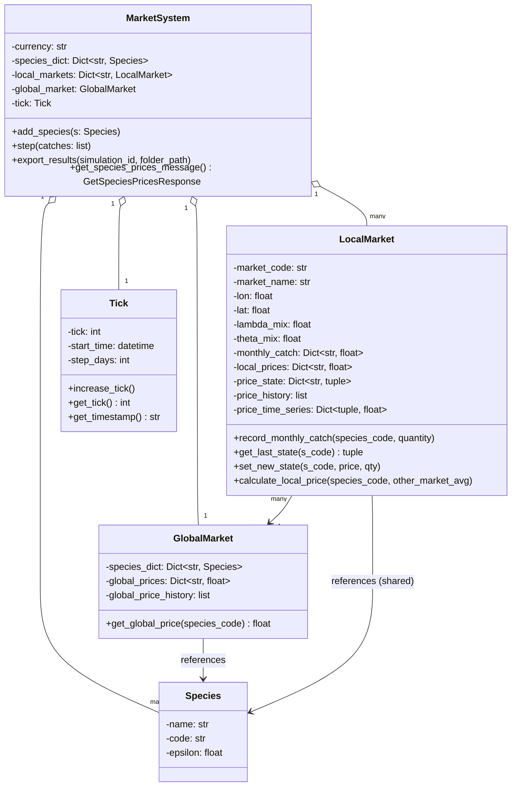
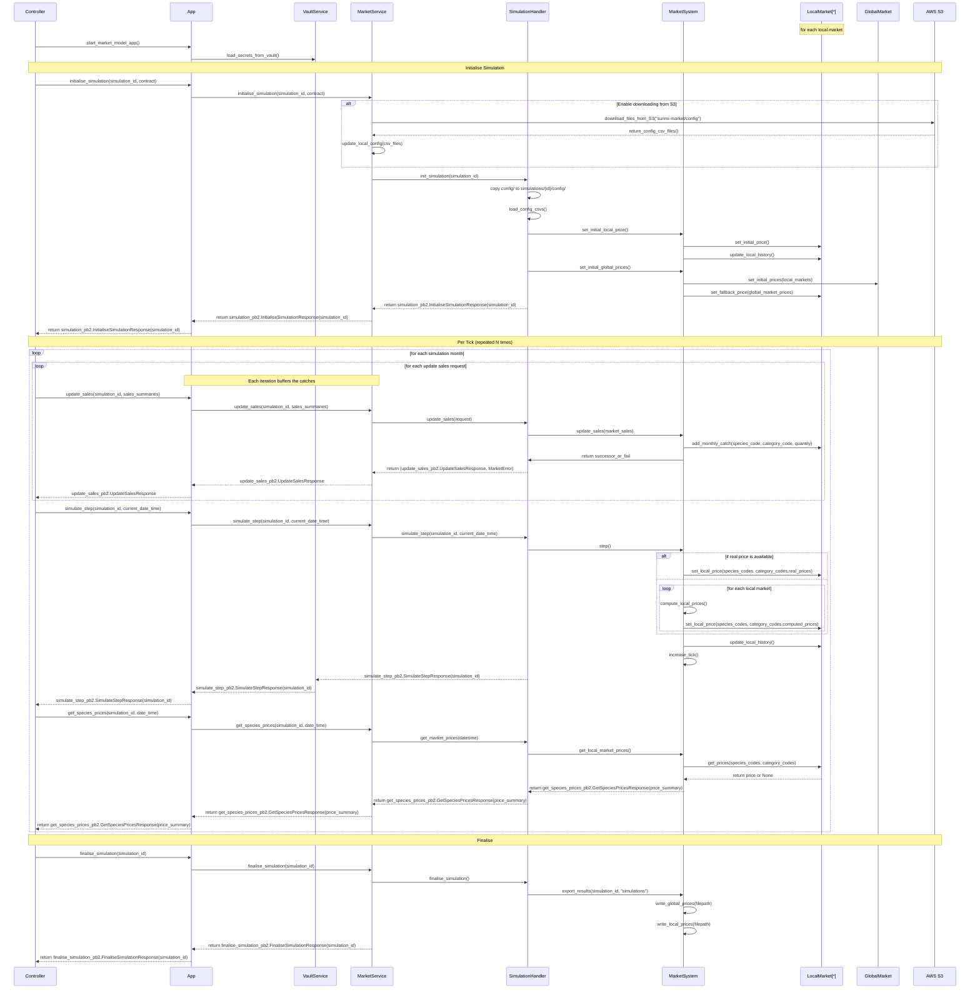
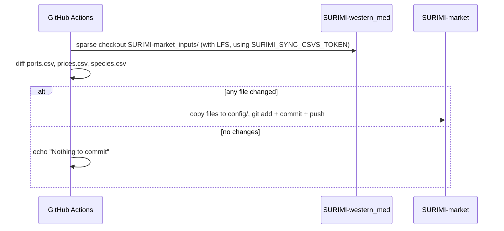

# SURIMI Market Model — Technical Documentation

---

## Table of Contents

1. [Overview](#1-overview)
   - [Licence](#licence)
   - [Responsibilities](#responsibilities)
   - [Build Outputs](#build-outputs)
2. [Service Architecture](#2-service-architecture)
3. [Simulation Lifecycle](#3-simulation-lifecycle)
4. [Market Price Model](#4-market-price-model)
   - 4.1 [Global Market](#41-global-market)
   - 4.2 [Local Market](#42-local-market)
   - 4.3 [Price Update Formula](#43-price-update-formula)
   - 4.4 [Baseline Price Initialization](#44-baseline-price-initialization)
5. [gRPC API](#5-grpc-api)
   - 5.1 [WorkflowService](#51-workflowservice)
   - 5.2 [MarketProviderService](#52-marketproviderservice)
6. [Data Management](#6-data-management)
   - 6.1 [Input Configuration Files](#61-input-configuration-files)
   - 6.2 [Output Files](#62-output-files)
   - 6.3 [S3 Bucket](#63-s3-bucket)
   - 6.4 [Nightly Config Sync](#64-nightly-config-sync)
7. [Kubernetes](#7-kubernetes)
8. [Environment](#8-environment)
9. [CI/CD](#cicd)
10. [Deployment](#10-deployment)
11. [Technology Stack](#11-technology-stack)
12. [Infrastructure & Observability](#12-infrastructure--observability)
    - 12.1 [Error Handling](#121-error-handling)
    - [Logging](#logging-loggerpy)
13. [Project Structure](#13-project-structure)
14. [Source Control](#14-source-control)
15. [Testing](#15-testing)
16. [Known Limitations](#16-known-limitations)

---

## 1. Overview

The **SURIMI Market Model** is a gRPC microservice that simulates fish market price dynamics as part of the broader **SURIMI** research project — a European initiative (2024–2027) developing socio-ecological models to support marine management strategy evaluation under the EU's **European Digital Twin of the Ocean (EU DTO)**.

The service answers the question: *how do fish prices respond to changes in catch volume?* It models two levels of price formation:

- **Local markets** (individual ports, identified by UN/LOCODE) where prices vary with supply according to species-specific elasticity.
- A **global market** that computes a supply-weighted average across all active local markets.

The service integrates into a larger simulation framework alongside other models (e.g., EwE, Poseidon, CMSY). An external workflow controller drives the simulation tick by tick, pushing catch data in and reading prices back out via gRPC.

Geographic scope: **Western Mediterranean Sea**, ~30 ports, ~150 species, historical price data from 2013 onwards.

**Language:** Python 3.12

**IDE:** Visual Studio Code

### Licence

<!-- TODO: confirm and add a LICENSE file to the repository -->

The licence for this project has not yet been specified. No `LICENSE` file is present in the repository.

## Responsibilities

The SURIMI Market Model is solely responsible for **fish market price simulation**. Specifically, it:

- Maintains per-simulation state: species catalogue, local markets (ports), and a global market aggregator.
- Accepts catch data pushed by the external workflow controller each tick (`UpdateSales`) and buffers it until the tick is stepped.
- Computes updated local prices each tick using the Elser elasticity formula, then derives a global average across all active local markets (`SimulateStep`).
- Serves current prices back to the controller on demand (`GetSpeciesPrices`).
- Snapshots configuration at simulation start, and writes output CSVs (`global_prices.csv`, `local_prices.csv`) on finalisation.
- Uploads simulation results to AWS S3 and downloads the latest configuration from S3 on initialisation (when credentials are present).

The model does **not** decide when ticks occur, what catch volumes to use, or how to interpret prices — those concerns belong to the external controller and the other SURIMI components (EwE, Poseidon, CMSY).

### Build outputs

This is a pure-Python project; there are no compiled native binaries. The single deployable artefact is a **Docker image**:

| Artefact | Build command | Description |
|---|---|---|
| `surimi-market` (Docker image) | `docker build -t surimi-market .` | Multi-stage image based on `python:3.12-slim`. The `builder` stage installs Python dependencies; the `runner` stage copies only the application source (`src/`, `server/`, `util/`) and the pre-installed site-packages. Entrypoint: `python -u server/app.py`. Exposes port `5001`. |

No `.whl`, `.egg`, or other distribution packages are produced by this repository.

---

## 2. Service Architecture

The SURIMI Market Model is a **gRPC microservice** structured in three layers: a thin transport layer (`server/`), a simulation management layer (`SimulationHandler`), and a domain model layer (`src/`). The transport layer exposes two gRPC services — `WorkflowService` for lifecycle management and `MarketProviderService` for per-tick data exchange — both sharing a `simulation_dictionary` that maps simulation IDs to their `SimulationHandler` instances. Each `SimulationHandler` owns a single `MarketSystem`, which in turn composes a species catalogue, a collection of `LocalMarket` objects (one per active port), a `GlobalMarket` aggregator, and a `Tick` counter. Communication with external systems (HashiCorp Vault for secrets, AWS S3 for config and result files) is handled by dedicated service modules (`vault_service.py`, `s3_storage.py`) that are called at startup and on simulation lifecycle events respectively. The server process is stateless beyond the in-memory `simulation_dictionary`; all persistent state is written to the `simulations/` directory on finalisation.

### Component Overview

TODO ask Rik about whether the Controller side is represented correctly.
TODO Explaining the model in plain text
- What "config/CSV files" are we reading on init?


### Domain Model

<!-- TODO use an automated tool to create the class diagrams. -->

This diagram reflects the class structure in `src/market_model.py`.



---

## 3. Simulation Lifecycle

A simulation proceeds in three phases: **Initialise**, one or more **tick iterations**, and **Finalise**. The external controller orchestrates this sequence.

<!-- Ask third-part person for feedback on this diagram. -->



---

## 4. Market Price Model

### 4.1 Global Market

At the moment global market (`GlobalMarket`) does not apply any price-adjustment model. It computes a **simple arithmetic mean** of valid local prices for each species across all active local markets at the end of every tick.

```
GlobalPrice(s) = mean({ LocalPrice(m, s) | LocalPrice(m, s) is valid })
```

If no local market has a valid price for a species, `GlobalPrice(s)` is `None` for that tick.

The global price serves two roles:
1. **Fallback during baseline initialization** — if a local market has no CSV price for a species, it inherits the global average.
2. **Optional mixing signal** — if `lambda_mix > 0` on a local market, the global price pulls the local price toward the global average each tick (see §4.2).

### 4.2 Local Market

Each `LocalMarket` tracks its own price per species. After every catch update, prices are driven by **supply changes** via the Elser adjustment (§4.3). Two optional mixing parameters can then blend the result with external signals:

| Parameter | Symbol | Effect |
|---|---|---|
| `lambda_mix` | λ | Blends local price toward the global average |
| `theta_mix` | θ | Blends local price toward a neighbor-market average |

Mixing is applied **after** the Elser update:

```
P = (1 - λ) * P_local + λ * P_global      # global pull
P = (1 - θ) * P       + θ * P_neighbors   # neighbor pull
```

Both parameters default to `0.0` in the current implementation (no mixing by default).

### 4.3 Price Update Formula

Local prices are updated each tick using the **Elser elasticity adjustment**, derived from Elser et al. (2018) — [doi:10.1016/j.ecolecon.2018.09.008](https://doi.org/10.1016/j.ecolecon.2018.09.008).

The formula applied in `MarketSystem._update_local_prices()` (`src/market_model.py:219`):

```
P_new = P_last * (Q_last / Q_new) ^ ε
```

| Symbol | Meaning |
|---|---|
| `P_new` | Updated price this tick (EUR/kg) |
| `P_last` | Price from the previous tick |
| `Q_last` | Catch quantity from the previous tick (kg) |
| `Q_new` | Catch quantity this tick (kg); floored at `1e-6` to avoid division by zero |
| `ε` | Price elasticity coefficient for the species (default `0.5`) |

**Interpretation:**
- If catch increases (`Q_new > Q_last`), price falls — more supply, lower price.
- If catch decreases (`Q_new < Q_last`), price rises — less supply, higher price.
- `ε` controls sensitivity. At `ε = 1` the response is proportional; at `ε = 0.5` it is dampened (square-root scaling).
- Only species with a recorded catch this tick are updated. Species with no catch keep their previous price unchanged.

### 4.4 Baseline Price Initialization

Before tick 0 the model initializes prices in three phases (`MarketSystem._initialize_baseline_prices_from_csv`):

```
Phase 1 — CSV:        LocalPrice(m, s) = earliest price in prices.csv for (m, s)
Phase 2 — Global avg: GlobalPrice(s)   = mean of all valid LocalPrice(*, s) from Phase 1
Phase 3 — Fallback:   If LocalPrice(m, s) still None → set to GlobalPrice(s)
                       If GlobalPrice(s) also None → leave as None (logged as warning)
```

The global price computed in Phase 2 is not recorded in `global_price_history`; history starts from the first `step()` call.

---

## 5. gRPC API

The protocol is defined in the external [SURIMI Protocol repository](https://github.com/Official-EwE/SURIMI-protocol) and consumed as a versioned Python package from `buf.build`.

### 5.1 WorkflowService

Manages simulation lifecycle. Implemented in `server/workflow_service.py`.

| RPC | Request | Response | Description |
|---|---|---|---|
| `Initialise` | `InitialiseRequest` | `InitialiseResponse` | Creates a new simulation instance. Downloads config from S3, loads CSV data, initializes baseline prices. Fails if `simulation_id` already exists. |
| `SimulateStep` | `SimulateStepRequest` | `SimulateStepResponse` | Executes one monthly tick: flushes buffered catches into the market engine, updates prices, advances the tick counter. |
| `Finalise` | `FinaliseRequest` | `FinaliseResponse` | Exports `global_prices.csv` and `local_prices.csv`, then uploads the simulation directory to S3. |
| `Cancel` | `CancelRequest` | `CancelResponse` | Removes the simulation from the active dictionary without writing results. |
| `GetProtocolVersion` | `GetProtocolVersionRequest` | `GetProtocolVersionResponse` | Returns the git commit hash of the installed protobuf SDK package (derived from the package version string). |

### 5.2 MarketProviderService

Handles per-tick data exchange. Implemented in `server/market_provider_service.py`.

| RPC | Request | Response | Description |
|---|---|---|---|
| `GetSpeciesPrices` | `GetSpeciesPricesRequest` | `GetSpeciesPricesResponse` | Returns current prices for all (species, market) combinations that have a valid price. Skips combinations where price is `None`. |
| `UpdateSales` | `UpdateSalesRequest` | `UpdateSalesResponse` | Receives catch data (sales summaries with species, market, category, and quantity). Aggregates quantities into `pending_catch_dict`; they are consumed on the next `SimulateStep` call. May be called multiple times per tick. |

Both services share a `simulation_dictionary: dict[str, SimulationHandler]` injected at startup. All RPCs return `INVALID_ARGUMENT` if the `simulation_id` is unknown.

---

## 6. Data Management

### 6.1 Input Configuration Files

All three files live in `config/` and are synced nightly from `SURIMI-western_med` (see §6.4).

| File | Key columns | Description |
|---|---|---|
| `species.csv` | `species_code`, `species_name` | ~150 Western Mediterranean species. `epsilon` defaults to `0.5` for all (not in CSV). |
| `ports.csv` | `port_code`, `port_name`, `lon`, `lat` | ~30 ports, identified by UN/LOCODE (e.g. `ESALG`). |
| `prices.csv` | `date`, `market_code`, `species_code`, `category_code`, `price`, `currency`, `measurement_unit` | Historical price time series, 2013 to present. ~2.3 MB. |

On `Initialise`, the global `config/` directory is copied to `simulations/<simulation_id>/config/` to snapshot the inputs at the time of the run.

### 6.2 Output Files

Both files are written under `simulations/<simulation_id>/` on `Finalise`.

**`global_prices.csv`**

| Column | Type | Description |
|---|---|---|
| `tick` | int | Simulation tick number (0-based) |
| `species` | str | Species code |
| `avg_price` | float | Mean price across all local markets (blank if None) |
| `total_catch` | float | Sum of catches across all local markets (kg) |

**`local_prices.csv`**

| Column | Type | Description |
|---|---|---|
| `tick` | int | Simulation tick number |
| `market` | str | Port UN/LOCODE |
| `species` | str | Species code |
| `price` | float | Local price (blank if None) |
| `catch` | float | Catch recorded at this market this tick (kg) |

### 6.3 S3 Bucket

Implemented in `server/s3_storage.py`. AWS credentials are injected via environment variables loaded from Vault (see §9).

| Event | Direction | S3 path |
|---|---|---|
| `Initialise` | Download | `surimi-market/config/` → `config/` |
| `Finalise` | Upload | `simulations/<id>/` → `surimi-market/simulations/<id>/` |

`.bin` files are skipped on upload. `.keep` files and S3 directory entries are skipped on download. If `AWS_BUCKET_NAME` or `AWS_ACCESS_KEY_ID` are not set, the operation is silently skipped.

#### S3 bucket authentication

S3 credentials are **long-lived AWS access keys** (`AWS_ACCESS_KEY_ID` / `AWS_SECRET_ACCESS_KEY`) stored as secrets in HashiCorp Vault. At server startup, `VaultService.LoadVaultSecretsInEnvironmentVariables()` authenticates to Vault using a `VAULT_TOKEN` and reads the entire secret from the configured KV path into the process environment. By the time any S3 operation is triggered (on `Initialise` or `Finalise`), the AWS credentials are already present as environment variables and are picked up transparently by the `boto3` client. This means the credentials never appear in the Docker image, the repository, or any config file — they exist only in Vault and in the running process's environment.

### 6.4 Nightly Config Sync

Defined in `.github/workflows/sync-market-inputs.yml`. Runs at **02:00 UTC** every day (also triggerable manually).



The Personal Access Token (`SURIMI_SYNC_CSVS_TOKEN`) expires **2027-02-12**.

---

## 7. Kubernetes

In production the SURIMI Market Model is deployed as a container workload inside the **EDITO Datalab** Kubernetes cluster — the cloud infrastructure provided by the EU Digital Twin of the Ocean platform. The Docker image is pushed to a container registry accessible by the cluster, and the service runs as a Kubernetes `Deployment` with the gRPC port (`5001`) exposed via a `Service`. HashiCorp Vault is available within the same cluster network, so the container can authenticate at startup and retrieve AWS credentials without any secrets being stored in Kubernetes manifests or environment variable literals. Simulation result files written to the `simulations/` directory are transient to the pod; durable storage of results relies on the S3 upload performed at `Finalise` (see §6.3).

---

## 8. Environment

| Variable | Required | Default | Description |
|---|---|---|---|
| **gRPC** | | | |
| `GRPC_HOST` | No | `[::]` | Bind address for the gRPC server |
| `GRPC_PORT` | No | `5001` | Listening port |
| **HashiCorp Vault** | | | |
| `VAULT_ADDR` | Yes (prod) | — | Vault server URL |
| `VAULT_TOKEN` | Yes (prod) | — | Authentication token |
| `VAULT_TOP_DIR` | Yes (prod) | — | Top-level path in Vault KV store |
| `VAULT_RELATIVE_PATH` | Yes (prod) | — | Relative secret path under `VAULT_TOP_DIR` |
| `VAULT_MOUNT` | Yes (prod) | — | KV mount point |
| **AWS S3** | | | |
| `AWS_BUCKET_NAME` | Yes (prod) | — | S3 bucket name |
| `AWS_ACCESS_KEY_ID` | Yes (prod) | — | AWS access key (loaded from Vault) |
| `AWS_SECRET_ACCESS_KEY` | Yes (prod) | — | AWS secret key (loaded from Vault) |
| `AWS_SESSION_TOKEN` | No | — | Temporary session token (if using STS) |
| `AWS_DEFAULT_REGION` | Yes (prod) | — | AWS region |
| `AWS_S3_ENDPOINT` | Yes (prod) | — | S3 endpoint hostname (without `https://`) |
| **OpenTelemetry** | | | |
| `OTEL_EXPORTER_OTLP_ENDPOINT` | No | `http://localhost:4317` | OTLP collector endpoint |
| `OTEL_SERVICE_NAME` | No | `market` | Service name reported to the collector |

Vault and AWS variables can be provided via a `.env` file (not committed to the repository). If all Vault variables are absent, Vault loading is silently skipped; if AWS variables are absent, S3 operations are silently skipped.

---

## 9. CI/CD

Two GitHub Actions workflows run on this repository.

### Unit tests (`unit-test.yml`)

Triggers on every **push and pull request** to any branch. Sets up Python 3.12, installs dependencies from `requirements.txt`, and runs the full `pytest` suite. This is the primary gate for catching regressions before merge.

### Docker build & push (`docker.yml`)

Triggers on every push to **`main`**. Builds the Docker image from `Dockerfile` and pushes it to the **GitHub Container Registry (GHCR)**:

| Image | Registry | Tag |
|---|---|---|
| `surimimarket` | `ghcr.io/official-ewe/surimimarket` | `latest` |

Authentication to GHCR uses the automatically-provided `GITHUB_TOKEN` (no manually managed secret required). After a successful push, the `latest` tag on GHCR is the image used for production deployment in the EDITO Datalab Kubernetes cluster (see §7. Kubernetes).

---

## 10. Deployment

### Docker

The service ships as a single Docker image built from `python:3.12-slim`.

```dockerfile
# Build
docker build -t surimi-market .

# Run (minimal, no Vault/S3)
docker run -p 5001:5001 surimi-market

# Run with credentials
docker run -p 5001:5001 \
  -e VAULT_ADDR=... \
  -e VAULT_TOKEN=... \
  ... \
  surimi-market
```

The container exposes port `5001`. The entrypoint is `python -u server/app.py` (`-u` ensures stdout/stderr are unbuffered for immediate log visibility).

### Local Development

```bash
python -m venv .venv
source .venv/bin/activate   # Windows: .venv\Scripts\activate
pip install -r requirements.txt

# Create .env with Vault credentials (optional — service runs without S3/Vault in dev)
python server/app.py
```

### Dependency Note

The gRPC Python SDK (`surimi-surimi-protocol-grpc-python`) is pinned to a specific build from `buf.build`. Newer versions of `grpcio` can introduce OpenTelemetry / protobuf conflicts in Docker builds — update dependencies cautiously and test inside Docker before releasing.

---

## 11. Technology Stack

| Package | Role |
|---|---|
| `grpcio` | Core gRPC runtime — handles transport, serialisation, and the server thread pool. |
| `grpc-interceptor` | Provides a cleaner interceptor API used by `ExceptionMetadataInterceptor` and `version_metadata_interceptor` to attach error detail and protocol version metadata to every response. |
| `grpcio-reflection` | Exposes the gRPC server reflection protocol, allowing tools like `grpcurl` to introspect available services without a `.proto` file. |
| `protobuf` | Google Protocol Buffers runtime — deserialises/serialises gRPC request and response messages generated from the SURIMI protocol definition. |
| `surimi-surimi-protocol-grpc-python` | Versioned Python stubs generated from the [SURIMI Protocol repository](https://github.com/Official-EwE/SURIMI-protocol), consumed from `buf.build`. Pins the exact protobuf contract the service implements. |
| `boto3` | AWS SDK — used by `s3_storage.py` to download config files from and upload simulation results to S3. |
| `hvac` | HashiCorp Vault client — used by `vault_service.py` to authenticate and read secrets from the Vault KV store at startup. |
| `pandas` | Used in `SimulationHandler` to load and parse the CSV configuration files (`species.csv`, `ports.csv`, `prices.csv`). |
| `python-dotenv` | Loads a local `.env` file into the process environment, providing a convenient way to supply Vault and AWS credentials during local development without committing secrets. |
| `pytest` / `coverage` | Test runner and code coverage reporting for the unit test suite under `src/test/`. |
| `pyflakes` | Static analysis — catches unused imports and undefined names without running the code. |
| `pyyaml` | Used by the gRPC testing scripts (`grpc_requests/`) to parse YAML-formatted request fixtures. |


## 12. Infrastructure & Observability

### HashiCorp Vault (`server/vault_service.py`)

On startup, `VaultService.LoadVaultSecretsInEnvironmentVariables()` authenticates to Vault using `VAULT_TOKEN` and reads all key-value pairs from the configured secret path into the process environment. This is the primary mechanism for injecting AWS credentials in production without storing them in the image or the repository.

### OpenTelemetry

The service exports traces and metrics to an OTLP collector (default: `localhost:4317`). This is configured via the `OTEL_EXPORTER_OTLP_ENDPOINT` and `OTEL_SERVICE_NAME` environment variables, which are set in the Dockerfile and can be overridden at runtime.

## 12.1 Error Handling

Error handling follows two complementary patterns.

### Explicit errors — `MarketError`

Within the domain and simulation-management layers (`src/`, `SimulationHandler`), errors are returned as values rather than raised as exceptions. Functions that can fail return a `tuple[result, MarketError | None]`, where `MarketError` carries a gRPC `StatusCode` and a message. The caller checks the second element before using the first. This Go-inspired pattern makes control flow explicit and avoids unexpected exception propagation through the domain logic.

### Boundary interception — `ExceptionMetadataInterceptor`

Any exception that does escape to the gRPC transport layer is caught by `ExceptionMetadataInterceptor` (registered at server startup via `grpc-interceptor`):

- **`GrpcException`** (already a well-formed gRPC error) — logged with its status code and details, then re-raised unchanged so the client receives the original status.
- **Any other `Exception`** — logged with a full traceback, then wrapped in a new `GrpcException` with status `INTERNAL` and the message `"Error in market: <original message>"`. The trailing metadata on the response includes the `method` name and `application: market` to aid debugging.

This ensures that all unhandled exceptions surface to the client as a structured gRPC error rather than a silent failure or connection drop, while the full traceback is preserved in the server logs.

---

### Logging (`logger.py`)

All modules use a shared logger factory (`get_logger(name)`). Each logger writes to two sinks simultaneously:

| Sink | Location | Level |
|---|---|---|
| Console (stdout) | — | `DEBUG` |
| Rotating file | `logs/surimi.log` | `DEBUG` |

Log format: `YYYY-MM-DD HH:MM:SS LEVEL    logger_name - message`

The `logs/` directory is created automatically on first run and is excluded from git.

---

## 13. Project Structure

```
SURIMI-market/
├── server/              # gRPC transport layer: app entry point, WorkflowService,
│                        #   MarketProviderService, interceptors, Vault & S3 clients
├── src/                 # Domain model: MarketSystem, LocalMarket, GlobalMarket,
│                        #   SimulationHandler, Tick, Species
│   └── test/            # pytest unit tests (one file per domain class)
├── util/                # Shared utilities: MarketError, constants
├── config/              # CSV configuration files (species, ports, historical prices)
│                        #   synced nightly from SURIMI-western_med
├── simulations/         # Per-simulation output directories, created at runtime
│                        #   (gitignored except for .keep)
├── grpc_requests/       # Bruno collection for manual gRPC testing
├── scripts/             # Setup and server-start scripts (PowerShell + Bash),
│                        #   grpc_testing_framework.py
├── doc/                 # Architecture diagrams (PlantUML, draw.io)
├── logs/                # Runtime log files — created on first run, gitignored
├── .github/workflows/   # CI/CD: unit-test.yml, docker.yml, sync-market-inputs.yml
├── Dockerfile           # Multi-stage Docker build
├── requirements.txt     # Python dependencies
└── pyproject.toml       # pytest configuration (pythonpath)
```

---

## 14. Source Control

The repository is hosted on **GitHub** at [`https://github.com/Official-EwE/SURIMI-market`](https://github.com/Official-EwE/SURIMI-market). The default and production branch is `main`; pushing to `main` triggers the Docker build and push workflow (see CI/CD).

There are no git submodules. The SURIMI protocol stubs are consumed as a versioned Python package from `buf.build` rather than as a submodule, and the CSV configuration files are synced via a GitHub Actions workflow rather than a repository reference.

---

## 15. Testing

### Automated tests

Unit tests live in `src/test/` and are run with `pytest`. There is one test file per domain class:

| File | Coverage |
|---|---|
| `test_GlobalMarket.py` | `GlobalMarket` price aggregation |
| `test_LocalMarket.py` | `LocalMarket` price calculation and state management |
| `test_MarketSystem.py` | `MarketSystem` orchestration and baseline initialisation |
| `test_SimulationHandler.py` | `SimulationHandler` lifecycle and CSV loading |

Tests run automatically on every push and pull request via the `unit-test.yml` workflow. To run locally:

```bash
pytest
```

### Manual testing with Bruno

The `grpc_requests/` directory contains a **Bruno** collection (`opencollection.yml`) with pre-built requests for every gRPC RPC — including full simulation sequences under `SimulateStepsByTicks/` and `UpdateSalesByTicks/`. Open the collection in Bruno and point it at the environment file `grpc_requests/environments/SURIMI.yml` to target a running server.

For automated end-to-end testing without a GUI, `scripts/grpc_testing_framework.py` drives a complete simulation sequence using **grpcurl**. It requires Go and grpcurl to be installed, and is platform-independent (Windows, macOS, Linux). Run it while the server is running:

```bash
python scripts/grpc_testing_framework.py
```

The key parameter to customise is `STEPS` (number of simulation months to run).

---

## 16. Known Limitations

The following issues are tracked in `BUGS.md`.

| # | Severity | Status | Description |
|---|---|---|---|
| 1 | High | **Fixed** | Duplicate tick 0 in `global_prices.csv`. `_initialize_baseline_prices_from_csv` called `_compute_global_prices` which wrote a history entry before the first tick. Fixed by adding `save_history=False` to the init call. |
| 2 | High | Open | **Orphaned simulation on failed init.** The simulation is added to `simulation_dictionary` before S3 download and CSV loading. If either fails, the entry remains in a broken state, blocking re-initialization with the same ID. |
| 3 | Medium | Open | **Race condition on `pending_catch_dict`.** `UpdateSales` and `SimulateStep` run in separate gRPC threads with no lock guarding shared state. Concurrent calls can corrupt or silently drop catch data. |
| 4 | Medium | Open | **Per-simulation config copy never loaded.** `init_simulation` copies `config/` to `simulations/<id>/config/` but `load_initialization_data` always reads from the top-level `config/`. The per-simulation copy is unused. |
| 5 | Medium | Open | **Wrong tick index in `calculate_local_price`.** History entries use `len(self.price_history)` instead of the actual simulation tick, and omit the `"catches"` key present in `_update_local_history` snapshots. |
| 6 | Low | Open | **CSV parsing crashes on malformed data.** `float(row["price"])`, `float(row["lon"])`, and `float(row["lat"])` have no error handling; blank or non-numeric cells raise an uncaught exception and abort initialization. |
