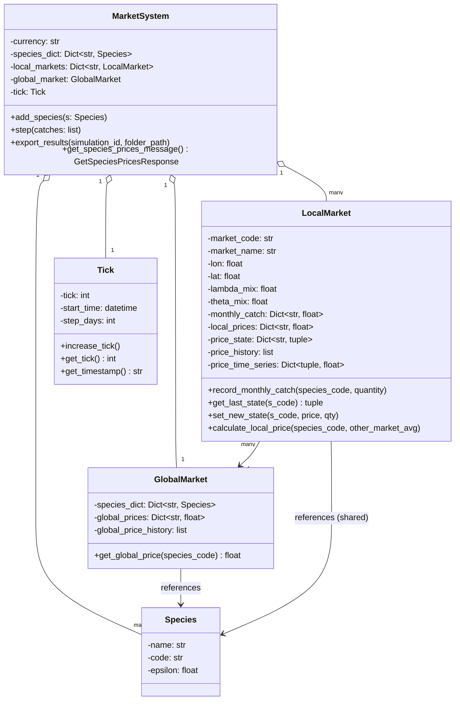
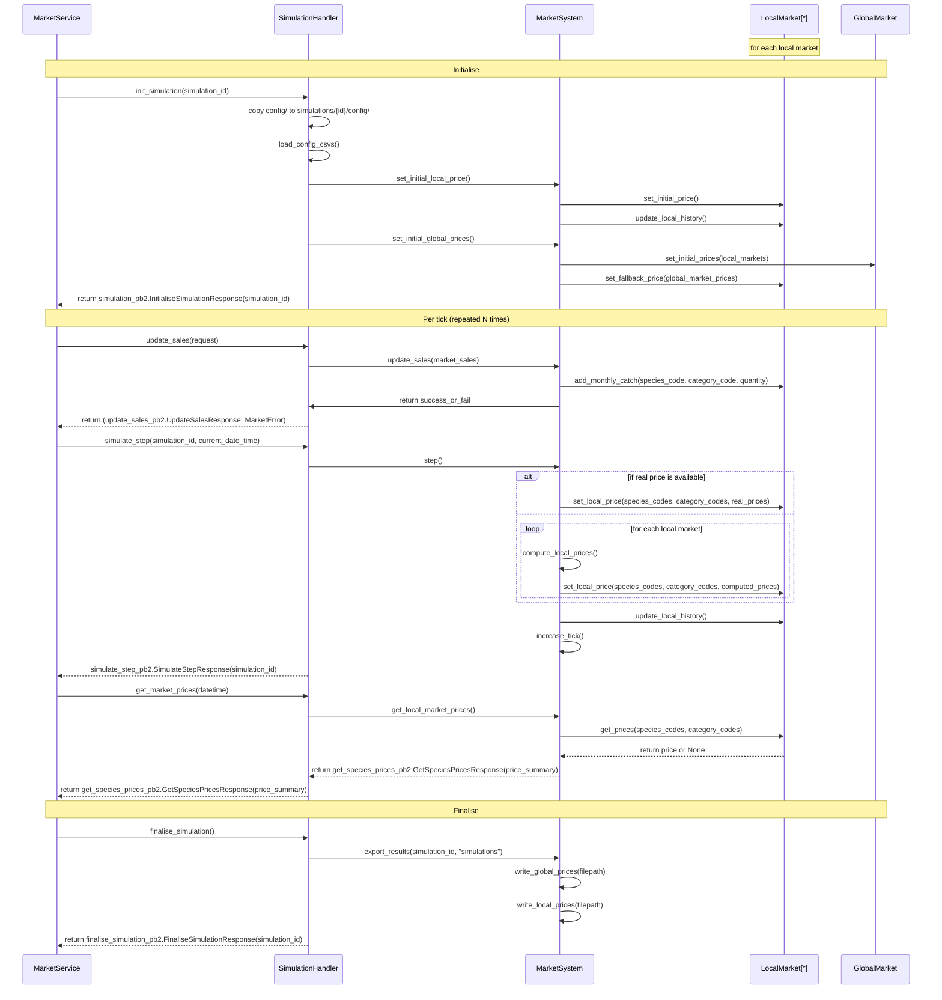

# Elsa Model — Architecture

This document describes the **elsa** model plugin (`src/models/elsa/`,
registered as `"elsa"` in `src/server/model_router.py` — the default
model if `MODEL_NAME` is unset). It is a separate, independently-selectable
plugin from **`market`** (`src/models/market/`, a more detailed
seasonal-plus-volume-response price model — see
`src/models/market/market_model_architecture.md`).

The framework layer above this plugin (Controller → App → `MarketService`,
shared across every model plugin) is documented in `market_architecture.md`.
This document starts at `SimulationHandler` (`ElsaHandler`), where
elsa-specific behavior begins.

---

## 1. Domain Model

<!-- TODO use an automated tool to create the class diagrams. -->

This diagram reflects the class structure in `src/market_model.py`.



---

## 2. Simulation Lifecycle



---

## 3. Market Price Model

### 3.1 Global Market

At the moment global market (`GlobalMarket`) does not apply any price-adjustment model. It computes a **simple arithmetic mean** of valid local prices for each species across all active local markets at the end of every tick.

```
GlobalPrice(s) = mean({ LocalPrice(m, s) | LocalPrice(m, s) is valid })
```

If no local market has a valid price for a species, `GlobalPrice(s)` is `None` for that tick.

The global price serves two roles:
1. **Fallback during baseline initialization** — if a local market has no CSV price for a species, it inherits the global average.
2. **Optional mixing signal** — if `lambda_mix > 0` on a local market, the global price pulls the local price toward the global average each tick (see §3.2).

### 3.2 Local Market

Each `LocalMarket` tracks its own price per species. After every catch update, prices are driven by **supply changes** via the Elser adjustment (§3.3). Two optional mixing parameters can then blend the result with external signals:

| Parameter | Symbol | Effect |
|---|---|---|
| `lambda_mix` | λ | Blends local price toward the global average |
| `theta_mix` | θ | Blends local price toward a neighbor-market average |

Mixing is applied **after** the Elser update:

```
P = (1 - λ) * P_local + λ * P_global      # global pull
P = (1 - θ) * P       + θ * P_neighbors   # neighbor pull
```

Both parameters default to `0.0` in the current implementation (no mixing by default).

### 3.3 Price Update Formula

Local prices are updated each tick using the **Elser elasticity adjustment**, derived from Elser et al. (2018) — [doi:10.1016/j.ecolecon.2018.09.008](https://doi.org/10.1016/j.ecolecon.2018.09.008).

The formula applied in `MarketSystem._update_local_prices()` (`src/market_model.py:219`):

```
P_new = P_last * (Q_last / Q_new) ^ ε
```

| Symbol | Meaning |
|---|---|
| `P_new` | Updated price this tick (EUR/kg) |
| `P_last` | Price from the previous tick |
| `Q_last` | Catch quantity from the previous tick (kg) |
| `Q_new` | Catch quantity this tick (kg); floored at `1e-6` to avoid division by zero |
| `ε` | Price elasticity coefficient for the species (default `0.5`) |

**Interpretation:**
- If catch increases (`Q_new > Q_last`), price falls — more supply, lower price.
- If catch decreases (`Q_new < Q_last`), price rises — less supply, higher price.
- `ε` controls sensitivity. At `ε = 1` the response is proportional; at `ε = 0.5` it is dampened (square-root scaling).
- Only species with a recorded catch this tick are updated. Species with no catch keep their previous price unchanged.

### 3.4 Baseline Price Initialization

Before tick 0 the model initializes prices in three phases (`MarketSystem._initialize_baseline_prices_from_csv`):

```
Phase 1 — CSV:        LocalPrice(m, s) = earliest price in prices.csv for (m, s)
Phase 2 — Global avg: GlobalPrice(s)   = mean of all valid LocalPrice(*, s) from Phase 1
Phase 3 — Fallback:   If LocalPrice(m, s) still None → set to GlobalPrice(s)
                       If GlobalPrice(s) also None → leave as None (logged as warning)
```

The global price computed in Phase 2 is not recorded in `global_price_history`; history starts from the first `step()` call.

---

## 4. Input and Output Files

### 4.1 Input Configuration Files

All three files live in `config/` and are synced nightly from `SURIMI-western_med` (see `market_architecture.md` §6.4).

| File | Key columns | Description |
|---|---|---|
| `species.csv` | `species_code`, `species_name` | ~150 Western Mediterranean species. `epsilon` defaults to `0.5` for all (not in CSV). |
| `ports.csv` | `port_code`, `port_name`, `lon`, `lat` | ~30 ports, identified by UN/LOCODE (e.g. `ESALG`). |
| `prices.csv` | `date`, `market_code`, `species_code`, `category_code`, `price`, `currency`, `measurement_unit` | Historical price time series, 2013 to present. ~2.3 MB. |

On `Initialise`, the global `config/` directory is copied to `simulations/<simulation_id>/config/` to snapshot the inputs at the time of the run.

### 4.2 Output Files

Both files are written under `simulations/<simulation_id>/` on `Finalise`.

**`global_prices.csv`**

| Column | Type | Description |
|---|---|---|
| `tick` | int | Simulation tick number (0-based) |
| `species` | str | Species code |
| `avg_price` | float | Mean price across all local markets (blank if None) |
| `total_catch` | float | Sum of catches across all local markets (kg) |

**`local_prices.csv`**

| Column | Type | Description |
|---|---|---|
| `tick` | int | Simulation tick number |
| `market` | str | Port UN/LOCODE |
| `species` | str | Species code |
| `price` | float | Local price (blank if None) |
| `catch` | float | Catch recorded at this market this tick (kg) |

---

## 5. Known Limitations

The following issues are tracked in `BUGS.md`.

| # | Severity | Status | Description |
|---|---|---|---|
| 1 | High | **Fixed** | Duplicate tick 0 in `global_prices.csv`. `_initialize_baseline_prices_from_csv` called `_compute_global_prices` which wrote a history entry before the first tick. Fixed by adding `save_history=False` to the init call. |
| 2 | Medium | Open | **Race condition on `pending_catch_dict`.** `UpdateSales` and `SimulateStep` run in separate gRPC threads with no lock guarding shared state. Concurrent calls can corrupt or silently drop catch data. |
| 3 | Medium | Open | **Per-simulation config copy never loaded.** `init_simulation` copies `config/` to `simulations/<id>/config/` but `load_initialization_data` always reads from the top-level `config/`. The per-simulation copy is unused. |
| 4 | Medium | Open | **Wrong tick index in `calculate_local_price`.** History entries use `len(self.price_history)` instead of the actual simulation tick, and omit the `"catches"` key present in `_update_local_history` snapshots. |
| 5 | Low | Open | **CSV parsing crashes on malformed data.** `float(row["price"])`, `float(row["lon"])`, and `float(row["lat"])` have no error handling; blank or non-numeric cells raise an uncaught exception and abort initialization. |
