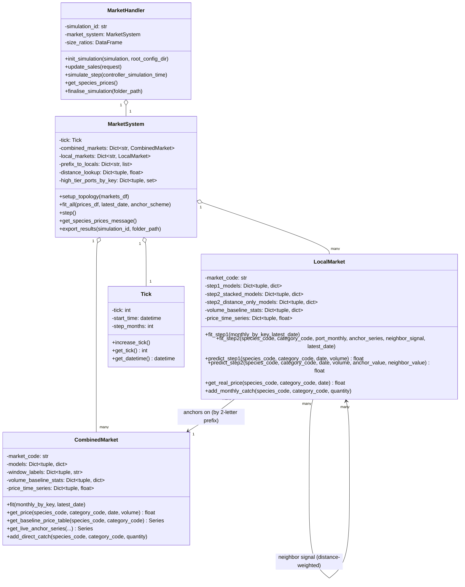
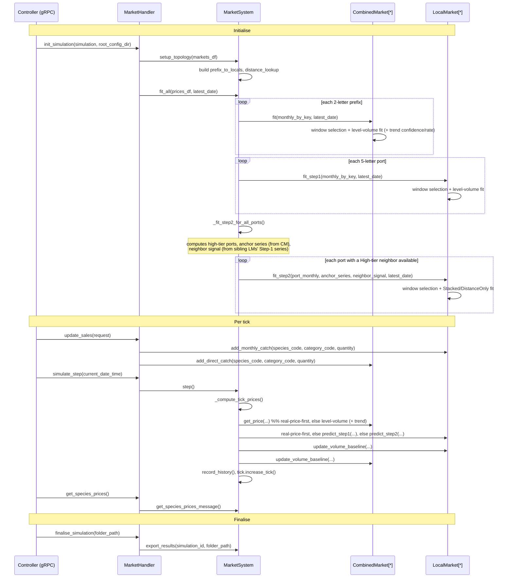
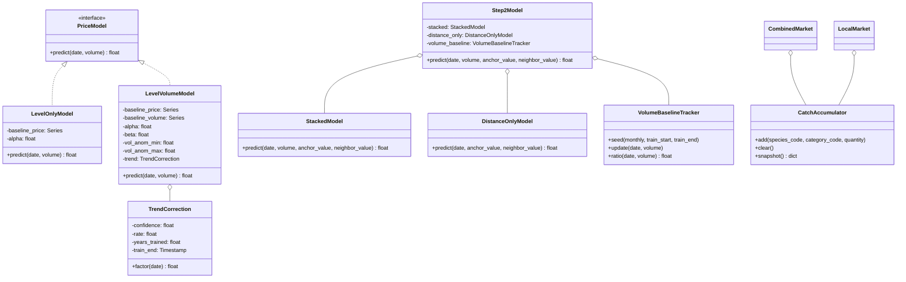

# `market` Plugin — Architecture

> This document describes the **`market`** model plugin (`src/models/market/`,
> registered as `"market"` in `src/server/model_router.py`). It is a separate,
> independently-selectable plugin from **`elsa`** (`src/models/elsa/`, a
> simpler Elser-elasticity price model) and **`arimax`**. The repo-root
> `market_architecture.md` documents `elsa`, not this plugin, despite its
> name — this document exists to give `market` the same kind of reference
> `elsa` already has.

---

## Table of Contents

1. [Overview](#1-overview)
2. [Current Architecture](#2-current-architecture)
   - 2.1 [Domain Model](#21-domain-model)
   - 2.2 [Simulation Lifecycle](#22-simulation-lifecycle)
3. [Market Price Model](#3-market-price-model)
   - 3.1 [CombinedMarket (national level)](#31-combinedmarket-national-level)
   - 3.2 [LocalMarket Step 1 (port level)](#32-localmarket-step-1-port-level)
   - 3.3 [LocalMarket Step 2 (neighbor-informed)](#33-localmarket-step-2-neighbor-informed)
   - 3.4 [Real-price-first](#34-real-price-first)
   - 3.5 [Window selection (shared methodology)](#35-window-selection-shared-methodology)
4. [Known Rough Edges](#4-known-rough-edges)
5. [Proposed Target Architecture](#5-proposed-target-architecture)
6. [Deferred / Future Work](#6-deferred--future-work)

---

## 1. Overview

The `market` plugin models fish prices for the **Western Mediterranean**
(Spain and France), using real historical landings/price data derived from
EMODnet (`src/models/market/data_prep/`). Where `elsa` applies one elasticity
formula uniformly to every species/port, `market` fits a **statistical
seasonal + volume-response model per species**, independently at two levels
of aggregation, with escalating fallback/degradation paths for when a given
level's data is too sparse or too extreme to trust.

Validated scope today: 5 species (`ANE`, `PIL`, `HKE`, `SAA`, `MUT`) across
the `ES` and `FR` national markets and their constituent 5-letter ports,
category `"Fresh - Whole"`, using the complete real historical record
(2010-01 through 2024-12 in the current pinned dataset).

---

## 2. Current Architecture

### 2.1 Domain Model



The fitting/prediction math itself is **not** methods on these classes — it
lives as standalone functions in sibling modules, called by `CombinedMarket`/
`LocalMarket` with their own state passed in as plain dicts and DataFrames:

| Module | Responsibility |
|---|---|
| `level_volume_model.py` | Level-only and level-volume fit/predict (shared by `CombinedMarket` and `LocalMarket` Step 1); trend-rate fit/predict (`CombinedMarket` only); shared volume-baseline and real-price bookkeeping helpers |
| `trend_confidence.py` | Continuous `[0,1]` trend confidence score, per key |
| `stacked_model.py` | High-tier port classification, distance-weighted neighbor signal, Stacked/DistanceOnly fit/predict (`LocalMarket` Step 2) |
| `window_selection.py` | Generic rolling-origin training-window search, reused identically by all three fit paths above |
| `market_topology.py` | 5-letter port code → 2-letter prefix grouping |
| `utility.py` | Haversine distance, pairwise port distance lookup |

### 2.2 Simulation Lifecycle



---

## 3. Market Price Model

### 3.1 CombinedMarket (national level)

Seasonal baseline + volume response, fit in log-price space:

```
log(price) = baseline_log_price[month] + alpha + beta * vol_anom
vol_anom   = (volume - baseline_volume[month]) / baseline_volume[month]
```

`vol_anom` is clipped to the min/max relative anomaly seen during training,
so a volume swing outside validated experience holds steady at the most
extreme observed response instead of extrapolating further.

A continuous **trend correction** is layered on top, multiplicatively, for
this level only:

```
trend_years = clip((date - train_end) / 365.25, 0, years_trained)
price_hat   = exp(log_price_above) * exp(confidence * rate * trend_years)
```

`confidence` (`[0,1]`) comes from per-calendar-month OLS significance;
`rate` comes from sequential 3-year block-average log-prices anchored
backward from `train_end`. Confidence is naturally ~0 for a species with no
real multi-year trend, making the correction a no-op without any branching.

Falls back to a level-only fit (no volume term) if the volume-anomaly series
is degenerate. **In the current validated data, this fallback never
triggers** — all 10 validated (species, market) pairs use the full
level-volume model.

### 3.2 LocalMarket Step 1 (port level)

The same level-volume model as §3.1 (same shared `level_volume_model.py`
functions), fit independently per 5-letter port. No trend correction —
that's `CombinedMarket`-only, since the trend-term work was only validated
at the national level.

Falls back to level-only more often here than at the national level — real
ports have sparser data than the national aggregate. **Measured on current
validated data: 155 level-volume fits vs. 19 level-only fallbacks** (~11%
of port/species combinations).

### 3.3 LocalMarket Step 2 (neighbor-informed)

Built on top of Step 1, for ports with a usable **High-tier neighbor**
(determined by each port's share of total species volume,
`stacked_model.compute_high_tier_ports`). `MarketSystem` computes two
inputs and hands them to `LocalMarket.fit_step2`:

- **Anchor series**: `CombinedMarket`'s frozen seasonal baseline for this
  species (the default, `ANCHOR_SCHEME_STATIC`), or `CombinedMarket`'s own
  live tick-by-tick prediction (`ANCHOR_SCHEME_LIVE`, analysis-only, used
  by the fidelity backtest to compare both).
- **Neighbor signal**: a distance-weighted blend of *other* ports' own
  Step-1 predicted series, using `utility.build_distance_lookup`.

Two sub-models are fit, and a **dynamic switch** picks between them per
tick based on how far that tick's volume is from the port's own normal
range (`LOW_VOLUME_RATIO_THRESHOLD = 0.10`, `HIGH_VOLUME_RATIO_THRESHOLD =
2.0`):

- **Stacked** — anchor + neighbor signal + the port's own volume response.
  Used for normal-volume months.
- **DistanceOnly** — anchor + neighbor signal, *no* volume term. Used for
  extreme-volume months, where a volume-response term (same instability
  `vol_anom` clamping exists for at Step 1/CombinedMarket) can't be trusted.

**Measured on current validated data:** Step 2 is fit for 160 of 174
port/species combinations (~92%) that have a Step-1 model; the real-data
volume-ratio distribution across 15,201 (port, species, month)
observations is **~80% Stacked / ~20% DistanceOnly** — both sub-models are
substantially exercised, not a rare edge case.

> **Known duplication** (see §4): this switch is currently implemented
> twice — once in `LocalMarket._blend_step2_predictions` (vectorized, used
> only during fit-time scoring) and again in `LocalMarket.predict_step2`
> (scalar, used at runtime).

### 3.4 Real-price-first

Both `CombinedMarket.get_price()` and `LocalMarket.get_real_price()` check
their own `price_time_series` (loaded from `prices.csv`'s blended rows)
first, and return the real recorded price directly whenever one exists —
prediction is only ever reached for a date with no real price.

### 3.5 Window selection (shared methodology)

All three fit paths above (`CombinedMarket.fit`, `LocalMarket.fit_step1`,
`LocalMarket.fit_step2`) select their training-window length the same way:
score each candidate window (`WINDOW_CANDIDATE_YEARS = {2yr, 3yr, 4yr, 6yr,
Full}`) via rolling-origin validation (`window_selection.py`, model-agnostic
— it only knows about `fit_fn`/`score_fn` closures the caller supplies),
then re-fit on the single best-scoring window against the complete real
history. `fit_step2` additionally retries the next-best-scoring candidate
if the top one's final re-fit fails or fails a sanity check (predicting a
non-positive price anywhere in real history).

---

## 4. Known Rough Edges

Captured from an architecture discussion on 2026-10-09; nothing here is
broken, but each is a concrete readability/maintainability cost.

| # | Where | Issue |
|---|---|---|
| 1 | ~~`LocalMarket._blend_step2_predictions` / `predict_step2`~~ | **Fixed.** Both called their own independent copy of the Stacked-vs-DistanceOnly volume-ratio switch; collapsed into `stacked_model.should_use_distance_only()`. Surfaced a real latent bug along the way: `predict_step2`'s scalar "no baseline yet" case produced `None`, which crashes under the `\|`-based vectorized form the shared function needs — fixed by producing `float("nan")` instead, which compares safely under both `\|` and `or`. |
| 2 | ~~`LocalMarket.fit_step2` call site (`MarketSystem._fit_step2_for_all_ports`)~~ | **Fixed.** Four loose positional arguments (`port_monthly`, `anchor_series`, `neighbor_signal`, `latest_date`) carried Step 2's whole handoff with no named structure; bundled into a `Step2FitInputs` dataclass (`LocalMarket.py`). |
| 3 | Every fit/predict function | **Partially fixed (Phase C1).** `CombinedMarket`'s and `LocalMarket`'s base model (`models[key]`) is now a typed `PriceModel` (`LevelOnlyModel`/`LevelVolumeModel`), not a dict with key-presence dispatch. Step 2's `step2_stacked_models`/`step2_distance_only_models` are still untyped dicts — that's Phase C3 (`Step2Model`/`StackedModel`/`DistanceOnlyModel`), not yet done. |
| 4 | `CombinedMarket.get_price`, `LocalMarket.predict_step1`/`predict_step2` | **Partially fixed (Phase C1).** `CombinedMarket.get_price`/`LocalMarket.predict_from_base_model` (renamed from `predict_step1`) now just call `PriceModel.predict(date, volume)` — the one-row-DataFrame wrapping moved inside the model classes themselves, collapsing 2 of the 3 call sites into 1 shared implementation. `predict_step2` still builds its own one-row DataFrame independently; that's Phase C3. |
| 5 | ~~`Utility.py`~~ | **Fixed.** Per `CONTRIBUTING.md`'s own naming table ("CamelCase for class files, otherwise snake_case"), this held no class and was renamed to `utility.py`. |
| 6 | `consts.py` | Every project constant lives flat in one file, grouped only by comment headers — currency/units, distance math, volume tiers, switch thresholds, window candidates, rolling-origin params, anchor schemes, trend confidence/rate, all undifferentiated. |
| 7 | ~~Repeated boilerplate~~ | **Fixed.** `monthly = monthly.copy(); monthly["month"] = monthly["date"].dt.month` was repeated 11 times across `level_volume_model.py`, `stacked_model.py`, and `LocalMarket.py`; collapsed into `level_volume_model.with_month_column()`. |
| 8 | ~~`stacked_model.distance_weighted_neighbor_signal` / `MarketSystem._weighted_neighbor_value`~~ | **Fixed.** Same pattern as #1: inverse-distance-weighted averaging was implemented twice, independently — vectorized over a whole historical series at fit time, scalar over one tick's candidates at runtime. The candidate-filtering/weight-computation (genuinely identical in both) was extracted into `stacked_model.compute_inverse_distance_weights()`; the aggregation math (genuinely different) was left alone in each caller. |
| 9 | ~~`CombinedMarket._direct_catch`/`add_direct_catch` vs. `LocalMarket._monthly_catch`/`add_monthly_catch`~~ | **Fixed.** Both classes now compose a shared `CatchAccumulator` instance; their public `add_direct_catch`/`add_monthly_catch`-style methods are unchanged, but the duplicated `defaultdict`+lock+add/clear/snapshot pattern is gone. |

---

## 5. Proposed Target Architecture

**Partially implemented.** Phase A (`CatchAccumulator`, below), Phase B
(`should_use_distance_only`, `compute_inverse_distance_weights`,
`Step2FitInputs` — fixing #1, #8, #2), and Phase C1 (`PriceModel`,
`TrendCorrection`, `LevelOnlyModel`, `LevelVolumeModel` — fixing #3 and #4
for the base model; also renamed `LocalMarket`'s `step1_*` members to
`models`/`fit_base_models`/`predict_from_base_model`/`get_base_predicted_series`)
have already landed. Everything else in this section — `Step2Model`,
`StackedModel`, `DistanceOnlyModel`, `VolumeBaselineTracker` — is still
pending sign-off (Phases C2/C3). The core move still ahead: Step 2's fitted
variants become real classes with a `predict()` method too, finishing what
Phase C1 started for the base model — resolving the rest of #3 and #4. #1
and #8 are already fixed at the function level (Phase B); wrapping them
into `Step2Model` here is about giving them a home as an object, not about
removing any remaining duplication.



**`CombinedMarket` and `LocalMarket` stay separate, unrelated classes — no
shared superclass.** They aren't substitutable for each other anywhere
(`MarketSystem` never treats them polymorphically: different collections,
different method surfaces, `LocalMarket` has a whole Step 2 layer
`CombinedMarket` has no equivalent of, `CombinedMarket` has the trend
correction `LocalMarket` never got), so there's no real "is-a" relationship
to express. The shared parts — `VolumeBaselineTracker`, `RealPriceLookup`,
and `CatchAccumulator` (fixing #9) — are things both classes *hold*, not
things both classes *are*. A superclass here would either stay nearly
empty, or end up unifying things that are genuinely different (`fit()` vs.
`fit_step1()`+`fit_step2()`), which tends toward a fragile base class rather
than a cleaner one.

What this changes, concretely:

- *(already done, Phase C1)* `CombinedMarket.models[key]` / `LocalMarket.models[key]`
  (renamed from `step1_models`) hold a `PriceModel` object, not a dict.
  `get_price()`/`predict_from_base_model()` (renamed from `predict_step1`)
  are now just `self.models[key].predict(date, volume)` — no branching.
- `LocalMarket.step2_stacked_models` + `step2_distance_only_models`
  collapse into one `step2_models[key]: Step2Model`, which calls the
  already-shared `should_use_distance_only()` (fixed in Phase B) from one
  place instead of two.
- *(already done, Phase B)* Step 2's fit-time handoff (previously 4
  positional args) is now one `Step2FitInputs` object, fixing #2.
- `VolumeBaselineTracker`/a `RealPriceLookup` object replace the shared
  free functions in `level_volume_model.py` that `CombinedMarket` and
  `LocalMarket` currently call against their own raw dicts.
- *(already done, Phase A)* A shared `CatchAccumulator` replaces
  `CombinedMarket._direct_catch` and `LocalMarket._monthly_catch`, fixing
  #9 — same object, instantiated once per market, instead of the same
  pattern hand-written twice under
  different names.
- *(already done, Phase B)* #8 lived in `MarketSystem`, not in either
  market class, so it needed its own fix separate from `Step2Model`:
  `stacked_model.compute_inverse_distance_weights()`, called from both the
  fit-time series construction and the runtime scalar computation.

> **Naming note:** `Step2Model` (and `PriceModel`/`LevelVolumeModel`
> above it, to a lesser degree) inherited "Step 1"/"Step 2" terminology
> from the existing code — which is exactly the non-descriptive naming
> called out in §6. Don't carry that forward uncritically: whoever
> implements this should pick names that say what the thing *is*
> (e.g. something naming the neighbor-informed/distance-weighted
> behavior) rather than which numbered step produced it, at the same
> time the rename in §6 happens — not before, and not separately.

What does **not** change:

- `window_selection.py` stays exactly as-is — it's already generic,
  reused identically in three places, and not a source of any identified
  problem.
- `MarketSystem`'s orchestration role is unchanged: it still computes the
  anchor series and neighbor signal and hands them to `LocalMarket`: that
  split (cross-market orchestration in `MarketSystem`, single-market
  fitting in the class) is already correct and is not being revisited.
- Per `CONTRIBUTING.md`'s file-naming convention, each new class gets its
  own `CamelCase.py` file rather than being added inside the existing
  snake_case function modules.

This is a real refactor, not a quick pass — it touches every fit/predict
call site and every test that currently builds a raw params dict by hand.
It should happen as its own scoped, reviewed piece of work once this
target shape is agreed, not alongside anything else.

---

## 6. Deferred / Future Work

### Rename "Step 1"/"Step 2" to something descriptive

Raised 2026-10-09: `fit_step1`/`fit_step2`, `step1_models`,
`step2_stacked_models`/`step2_distance_only_models`, `predict_step1`/
`predict_step2`, `get_step1_historical_series` — none of these names say
what the thing *is* (a level-volume fit; a neighbor-informed,
distance-weighted blend with a volume-stability switch), only which
numbered stage of the pipeline produced it. A reader has to already know
the pipeline to decode the name, rather than the name teaching them the
pipeline.

Deliberately not done now — this spans most of `LocalMarket.py` plus
every caller in `MarketSystem.py` and every test that references these
names, and renaming is cheapest done once alongside Phase C (§5), when
`step1_models`/`step2_*_models` are being replaced with typed objects
anyway. Doing it twice (rename now, restructure later) would be wasted
churn. Candidate direction, to revisit then rather than decide now: name
by what each stage *is* (its own model type/role), not by its position in
a numbered sequence.

### Validate the trend correction at LocalMarket Step 1 (port level)

The trend correction (§3.1) was built and validated against CombinedMarket
only — the 10 national-level species/market pairs. It was never extended
to LocalMarket Step 1, for reasons worth recording rather than re-deriving
each time this comes up:

- **The motivating problem was observed at the national level** (a
  20-year scenario-forecast chart flatlining for ANE@ES), so that's the
  level the whole mechanism was measured and checked against.
- **It doesn't currently leak into Step 2 either**:
  `CombinedMarket.get_baseline_price_table()` — the anchor Step 2 reads —
  returns the raw, untrended `baseline_price` series. A port's Step 2
  price carries none of the national trend today, even indirectly.
- **Individual ports have meaningfully sparser data than the national
  aggregate** (§3.2: Step 1 already falls back to level-only for ~11% of
  port/species pairs, vs. 0% at CombinedMarket) — fewer years per
  calendar month to tell a genuine multi-year trend apart from noise.
- **The SAA@FR lesson applies more severely with less data**: even the
  richer national series produced a confidently-measured but spurious
  trend from a cyclical (not genuinely trending) price history in one
  case. Thinner per-port series are more exposed to that same failure
  mode, not less.

**What validating this would mean, if picked up**: re-measure confidence
and rate at per-port granularity (not just assume the national figures
transfer), using the same long-horizon, many-cutoff methodology the
original trend-term work used — not the short 1-2 year horizon this
project's existing fidelity-backtest convention defaults to, which was
already shown to give a misleading picture for several species at the
national level. Start with the ports/species combinations with the
longest, cleanest history rather than all ~174 port/species pairs at
once, and expect some ports to measure a real trend and others not to —
the whole point of continuous confidence is that it's supposed to answer
that per-key, not be assumed uniformly true or false.
