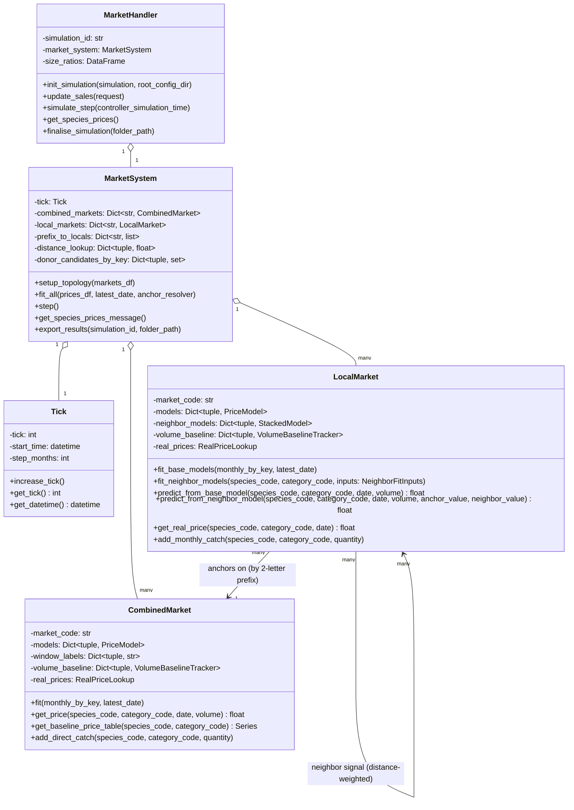
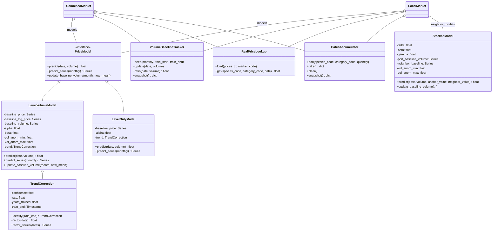
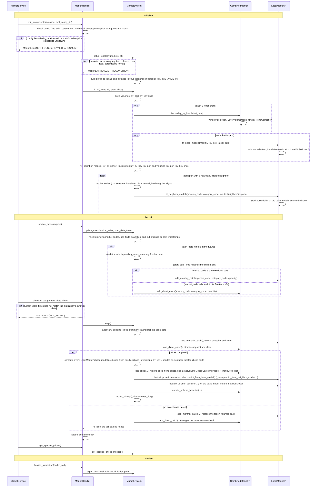
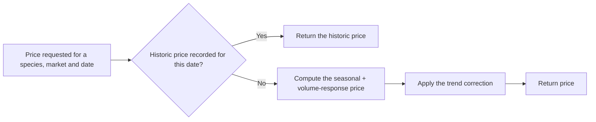
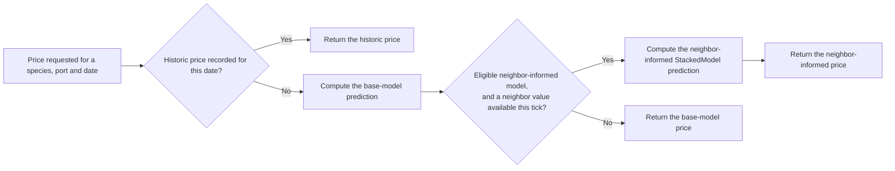

# Supply-Driven Seasonal Price Model — Architecture

## 1. Overview

The Supply-Driven Seasonal Price Model supplies first-sale fish prices to
the dynamic system formed by the coupled SURIMI models. At every
simulation step, it takes the landings reported by the other SURIMI
models (POSEIDON, EwE, Mice) and returns a price per species for
individual markets at local ports and accumulated prices at the national
level.

Each price is built up in layers:

- **Season:** each species follows its typical seasonal price pattern.
- **Supply:** prices shift when landings/catches depart from their
  seasonal baseline.
- **Trend:** at the national level, the model projects the long-run price
  trend forward: the more statistically certain the trend, the stronger
  its effect on future prices.
- **Local ports:** prices at individual local ports draw on the national
  price and on nearby ports, so thinly traded ports still receive a
  sensible price.

The model is fitted to historical first-sale prices derived from EMODnet
(`src/models/market/data_prep/`). When the simulation reaches a month for
which a historic price was recorded, it reports that price as-is; for
months without a historic price, it reports the model's prediction.

The model is implemented in the price simulation framework
(`src/models/market/`) and registered with its simulation handler
(`src/models/market/MarketHandler.py`).

---

## 2. Architecture

### 2.1 Domain Model



| Component | Responsibility |
|---|---|
| `MarketHandler` | The gRPC-facing entry point. Translates each request into a call on `MarketSystem` and back into a response. |
| `MarketSystem` | Orchestrates every `CombinedMarket`/`LocalMarket`. It sets up the market structure, fits the price models, and drives the simulation forward one tick at a time, computing and recording each tick's prices. |
| `Tick` | The simulation's current date and tick counter. |
| `CombinedMarket` | The national-level price model for one 2-letter market, with a trend correction. |
| `LocalMarket` | The port-level price model for one 5-letter port, with its own base and neighbor-informed models. |

### 2.2 Price Models and Shared Components



| Component | Responsibility |
|---|---|
| `PriceModel` | The common interface every price model implements, so `CombinedMarket` and `LocalMarket` can treat any of them the same way. |
| `LevelVolumeModel` | The seasonal-baseline-plus-volume-response model, kept in sync with real landings/catches as the simulation runs. |
| `TrendCorrection` | The long-run price trend applied on top of a `LevelVolumeModel`; ports use a no-op version instead of a real trend. |
| `LevelOnlyModel` | The no-volume-term fallback, used when there isn't enough data to support a volume response. |
| `StackedModel` | `LocalMarket`'s neighbor-informed model, blending a port's own data with its nearest geographic neighbors. |
| `VolumeBaselineTracker` | Tracks the landings/catches for one (species, category) key by calendar month, kept in sync every tick. |
| `RealPriceLookup` | Looks up a market's historic prices. |
| `CatchAccumulator` | Collects the landings/catches reported between ticks. |

### 2.3 Simulation Lifecycle

The framework layer above this (Controller → App → `MarketService`, shared
across every model plugin) is documented in `market_architecture.md`
Section 3. This diagram starts at `MarketHandler`, where `market`-specific
behavior begins.



---

## 3. Supply-Driven Seasonal Price Model

### 3.1 Combined Market



For each species at each national market, the model sets the price of a
simulated month in three steps:

1. **Seasonal price.** It starts from the typical price for that calendar
   month, learned from the historical prices.
2. **Supply adjustment.** It compares the month's landings/catches with
   the typical amount for that calendar month. Landings above the typical
   amount move the price one way, landings below it move the price the
   other way, and `beta` sets how strongly.
3. **Trend.** It carries the long-run price trend forward in time. The
   more statistically certain the trend, the larger its effect.

The model works with the logarithm of the price, so each adjustment acts
as a percentage change of the price.

#### Seasonal price and supply adjustment

Steps 1 and 2 as a formula:

```
log(price) = baseline_log_price[month] + alpha + beta * vol_anom
vol_anom   = (volume - baseline_volume[month]) / baseline_volume[month]
```

where, for one species at one national market:

| Variable | Meaning |
|---|---|
| `price` | The first-sale price the model reports for the month being simulated. |
| `month` | The calendar month (1–12) of the simulated date. It selects the seasonal values of baseline_log_price and baseline_volume. |
| `baseline_log_price[month]` | The typical log-price for the given calendar month, estimated from the historical prices in the selected training window. It carries the seasonal pattern. |
| `alpha` | A fitted constant that shifts the whole seasonal baseline up or down to the price level of the training window. |
| `beta` | The fitted volume-response coefficient: how strongly log-price moves for a given relative change in landings/catches. |
| `volume` | The landings/catches of the species reported for the simulated month by the other SURIMI models. |
| `baseline_volume[month]` | The typical landings/catches for the given calendar month, seeded from historical data and updated as the simulation runs. |
| `vol_anom` | The relative volume anomaly, i.e. how far volume lies above or below baseline_volume[month], as a fraction of it. |

`vol_anom` is clipped to the minimum and maximum relative anomaly seen
during training, so the volume response never exceeds the most extreme
response observed. When `baseline_volume[month] <= 0`, `vol_anom` is
`NaN`. Both rules apply to `CombinedMarket` here, and to the `LocalMarket`
base model and to `StackedModel` in Section 3.2.

**Interpretation:**
- Landings/catches above the typical amount for the month push the price
  down; below it, the price rises.
- `beta` sets the strength of that response — a larger `beta` means the
  same volume swing moves the price further.
- The response never exceeds what was seen during training: an extreme
  volume swing holds at the most extreme response observed, rather than
  extrapolating further.
- A calendar month with no usable baseline volume has no volume response
  at all.

If the volume-anomaly series has too few usable training rows, or
doesn't vary at all, the fit falls back to a level-only model (no
volume term).

#### Trend

Step 3, as a formula: it scales the step 1+2 price up or down by the
measured long-run trend, compounded over the time elapsed since training
ended — capped at the training window's own length, and muted in
proportion to how statistically confident that trend is:

```
elapsed_years = (date - train_end) / days_per_year
trend_years   = clip(elapsed_years, min_trend_years, years_trained)
price_hat     = exp(log_price_above) * exp(confidence * rate * trend_years)
```

where:

| Variable | Meaning |
|---|---|
| `date` | The simulated date being priced. |
| `train_end` | The last date of the training window used to fit the model. |
| `years_trained` | The length of the training window in years. It caps how far ahead the trend is extended. |
| `trend_years` | The years elapsed between train_end and date, clipped to the range 0 to years_trained. |
| `log_price_above` | The log-price from the seasonal level-volume formula, before any trend correction. |
| `confidence` | A score from 0 to 1 for how statistically certain the long-run trend is. |
| `rate` | The long-run trend in log-price per year. |
| `price_hat` | The trend-corrected first-sale price the model reports. |
| `days_per_year` | The average length of a year in days, including leap years (365.25). It converts the day difference between date and train_end into years. |
| `min_trend_years` | The lower bound of trend_years (0). For dates on or before train_end the trend has no effect, so it is only applied forward in time. |
| `clip(x, lower, upper)` | A function with three arguments that limits x to the range lower to upper. In the formula, x is elapsed_years, lower is min_trend_years and upper is years_trained. |
| `elapsed_years` | The years between train_end and date, before any limits are applied. |

`confidence` measures how statistically certain the long-run trend is,
using only data before `train_end`; a month backed by fewer years of
data needs stronger evidence to count as confident. `rate` is the
measured long-run trend in log-price per year, computed over the years
before `train_end`. For a species without a real multi-year trend,
`confidence` is close to 0, so the correction has no effect.

**Interpretation:**
- A species with a well-established, statistically confident long-run
  trend sees that trend continue into the forecast; a species with a
  weak or inconsistent trend doesn't.
- The trend's effect grows with time since training ended, but only up
  to the length of the training window itself — it is never extended
  further into the future than the data that measured it.
- For any date at or before the training window's end, the trend has no
  effect at all: it only ever pushes the price forward in time, never
  backward.

### 3.2 Local Market



Each port's price is built in two layers:

1. **Base model.** Fitted independently on the port's own history, using
   the same formula as Section 3.1.
2. **Neighbor-informed model.** For ports with a usable geographic
   neighbor, blends in nearby ports' own predictions on top of the base
   model.

#### Base model (port level)

The same seasonal-plus-volume-response model as Section 3.1, fitted
independently per 5-letter port, without the trend term: ports anchor on
`CombinedMarket`'s untrended seasonal baseline instead of fitting their
own trend. Where the volume-anomaly series has too few usable training
rows, or doesn't vary at all, the fit falls back to the level-only model
(no volume term), the same as at the national level.

#### Neighbor-informed model

A port with a usable neighbor gets a second model layered on top of the
base model. Its neighbors are its 5 closest local ports by geographic
distance, with closer ports counting for more. Two inputs feed this fit:

- **Anchor series**: `CombinedMarket`'s own seasonal baseline for this
  species.
- **Neighbor signal**: a distance-weighted blend of the other ports' own
  predicted prices.

`StackedModel` fits one combined formula: the port's own volume
response, same as the base model, plus a term for the neighboring
ports' predicted prices:

```
log(price) - log(anchor) = delta + beta * vol_anom + gamma * neighbor_anom
vol_anom      = clip((volume - port_baseline_volume[month]) / port_baseline_volume[month], vol_anom_min, vol_anom_max)
neighbor_anom = neighbor_value - neighbor_baseline[month]
```

where, for one species at one local port:

| Variable | Meaning |
|---|---|
| `price` | The first-sale price the model reports for the port and month being simulated. |
| `anchor` | The national seasonal baseline for this species, read from `CombinedMarket` (the Anchor series, above). |
| `delta` | A fitted constant shift between the port's price and the anchor. |
| `beta` | The fitted volume-response coefficient, the same role as in the base model. |
| `volume` | The port's own landings/catches for the simulated month. |
| `port_baseline_volume[month]` | The port's typical landings/catches for the given calendar month. |
| `vol_anom` | The port's own relative volume anomaly, clipped to the range seen during training. |
| `gamma` | The fitted neighbor-response coefficient: how strongly the price follows the neighbor signal. |
| `neighbor_value` | The distance-weighted blend of neighboring ports' own base-model predictions for this month (the Neighbor signal, above). |
| `neighbor_baseline[month]` | The typical value of `neighbor_value` for the given calendar month. |
| `neighbor_anom` | How far `neighbor_value` lies from `neighbor_baseline[month]`. |

`port_baseline_volume[month]` is kept in sync with the base model's own
baseline: every per-tick update applies to both, so the two models
compute the same volume anomaly.

**Interpretation:**
- A port's price tracks the national seasonal baseline, adjusted up or
  down by its own supply and by its nearest neighboring ports' own
  predicted prices.
- The port's own volume response works exactly like the base model's:
  above-typical landings/catches push the price down, below-typical
  landings/catches push it up, clipped to what was seen during training.
- When neighboring ports are predicted to have higher-than-usual prices,
  `gamma` pulls this port's price up too, and vice versa.
- Because everything is computed in log-space, the reported price can
  never be zero or negative.

### 3.3 Shared Mechanisms

#### Historic-price-first

Both `CombinedMarket` and `LocalMarket` check their own historic-price
lookup (a `RealPriceLookup` instance, loaded from `prices.csv`'s blended
rows) first, and return that price directly whenever one exists —
prediction is only ever reached for a date with no historic price.

#### Window selection

`CombinedMarket` and `LocalMarket`'s base models select their
training-window length the same way: score each candidate window
(`WINDOW_CANDIDATE_YEARS = {2yr, 3yr, 4yr, 6yr, Full}`) via model-agnostic
rolling-origin validation, then re-fit on the single best-scoring window
against the complete real history.

The neighbor-informed model reuses the window the base model already
selected for the same key, and fits `StackedModel` once on it. If the
base model is level-only, or the fit on that window fails, the port has
no neighbor-informed model for that key.

---

## 4. Input and Output Files

### 4.1 Input Configuration Files

| File | Key columns | Description |
|---|---|---|
| `species.csv` | `species_code` | The contracted species. |
| `markets.csv` | `market_code`, `market_name`, `lon`, `lat` | Every port and national market; 5-letter codes are local ports, 2-letter codes are national markets. |
| `prices.csv` | `date`, `market_code`, `species_code`, `category_code`, `price`, `landings_kg`, `size` | Historical first-sale prices and landings/catches. Rows with no `size` value are the blended real-price rows the model fits and reports against. |

An optional `size_ratios.csv` is also loaded if present, but not yet used
by any model logic.

### 4.2 Output Files

Both files are written under `simulations/<simulation_id>/` when the
simulation finishes.

**`combined_prices.csv`**

| Column | Description |
|---|---|
| `tick` | Simulation tick number. |
| `market_code` | The 2-letter national market code. |
| `species` | Species code. |
| `category_code` | Price category code. |
| `price` | The reported price (blank if none). |
| `volume` | Total landings/catches for this market, species and category this tick. |

**`local_prices.csv`**

| Column | Description |
|---|---|
| `tick` | Simulation tick number. |
| `market_code` | The 5-letter local port code. |
| `species` | Species code. |
| `category_code` | Price category code. |
| `price` | The reported price (blank if none). |
| `catch` | Landings/catches at this port, species and category this tick. |

---

## 5. Known Limitations

- **Spurious national trends.** A cyclical price history can produce a
  confidently measured trend that is not real. SAA in France is the
  known case (`confidence` 0.25).
- **Flat constants file.** All project constants live in `consts.py`,
  grouped only by comment headers (currency and units, distance, donor
  eligibility, window candidates, rolling-origin parameters, anchor
  schemes, trend confidence and rate).
