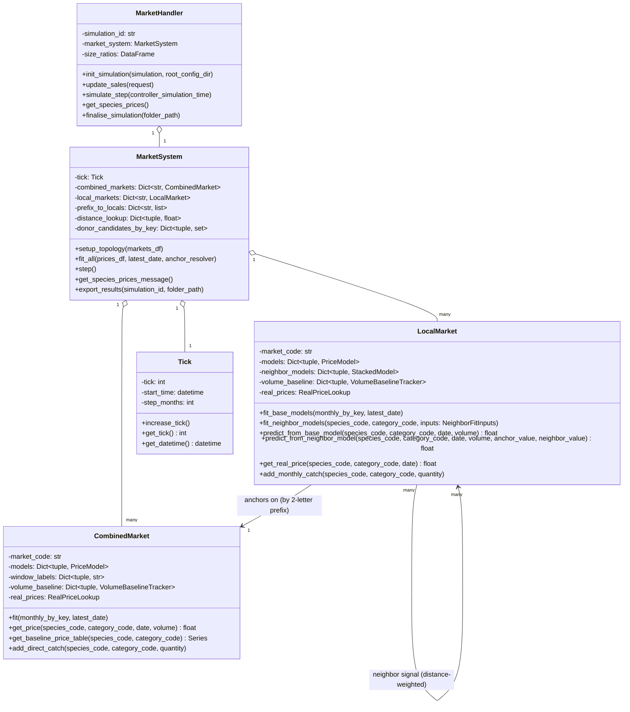
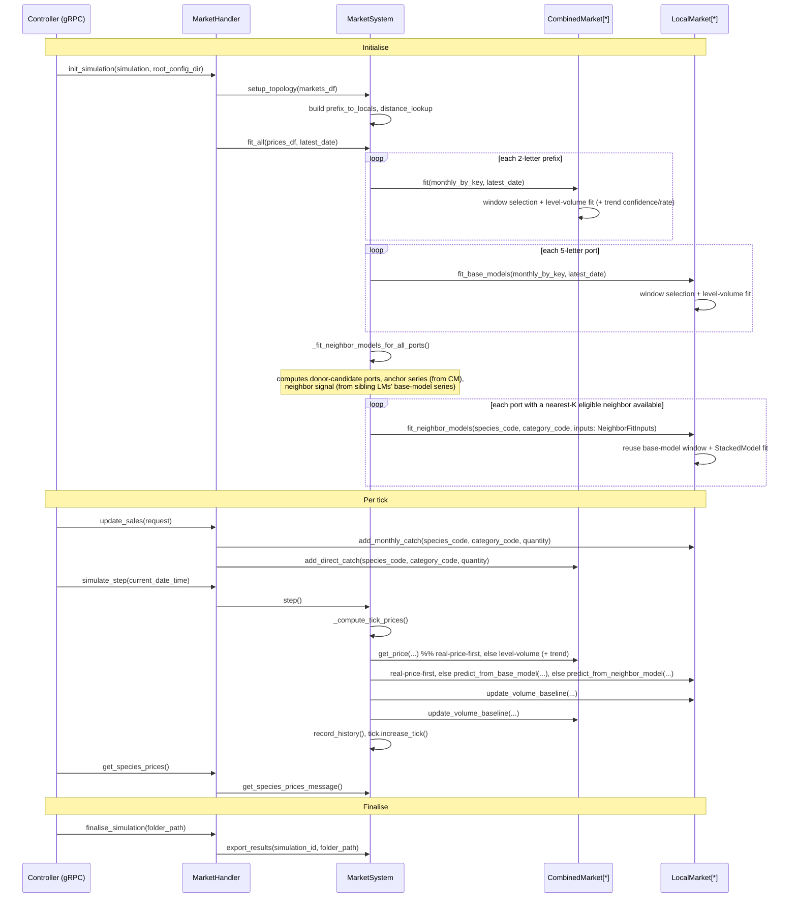
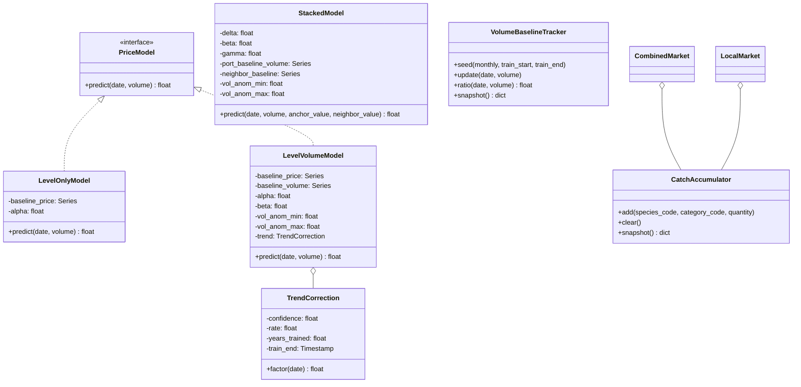

# `market` Plugin — Architecture

> This document describes the **`market`** model plugin (`src/models/market/`,
> registered as `"market"` in `src/server/model_router.py`). It is a separate,
> independently-selectable plugin from **`elsa`** (`src/models/elsa/`, a
> simpler Elser-elasticity price model) and **`arimax`**. The repo-root
> `market_architecture.md` documents `elsa`, not this plugin, despite its
> name — this document exists to give `market` the same kind of reference
> `elsa` already has.

---

## Table of Contents

1. [Overview](#1-overview)
2. [Current Architecture](#2-current-architecture)
   - 2.1 [Domain Model](#21-domain-model)
   - 2.2 [Simulation Lifecycle](#22-simulation-lifecycle)
3. [Market Price Model](#3-market-price-model)
   - 3.1 [CombinedMarket (national level)](#31-combinedmarket-national-level)
   - 3.2 [LocalMarket base model (port level)](#32-localmarket-base-model-port-level)
   - 3.3 [LocalMarket neighbor-informed model](#33-localmarket-neighbor-informed-model)
   - 3.4 [Real-price-first](#34-real-price-first)
   - 3.5 [Window selection (shared methodology)](#35-window-selection-shared-methodology)
4. [Known Rough Edges](#4-known-rough-edges)
5. [Proposed Target Architecture](#5-proposed-target-architecture)
6. [Deferred / Future Work](#6-deferred--future-work)

---

## 1. Overview

The `market` plugin models fish prices for the **Western Mediterranean**
(Spain and France), using real historical landings/price data derived from
EMODnet (`src/models/market/data_prep/`). Where `elsa` applies one elasticity
formula uniformly to every species/port, `market` fits a **statistical
seasonal + volume-response model per species**, independently at two levels
of aggregation, with escalating fallback/degradation paths for when a given
level's data is too sparse or too extreme to trust.

Validated scope today: 5 species (`ANE`, `PIL`, `HKE`, `SAA`, `MUT`) across
the `ES` and `FR` national markets and their constituent 5-letter ports,
category `"Fresh - Whole"`, using the complete real historical record
(2010-01 through 2024-12 in the current pinned dataset).

---

## 2. Current Architecture

### 2.1 Domain Model



The fitting/prediction math itself is **not** methods on these classes — it
lives as standalone functions in sibling modules, called by `CombinedMarket`/
`LocalMarket` with their own state passed in as plain dicts and DataFrames:

| Module | Responsibility |
|---|---|
| `level_volume_model.py` | Level-only and level-volume fit/predict (shared by `CombinedMarket` and `LocalMarket`'s base model); trend-rate fit (`fit_trend_rate_model`) and trend-correction predict (`CombinedMarket` only); shared volume-baseline and real-price bookkeeping helpers |
| `trend_confidence.py` | Continuous `[0,1]` trend confidence score, per key |
| `stacked_model.py` | Nearest-K donor selection, distance-weighted neighbor signal, StackedModel fit/predict (`LocalMarket`'s neighbor-informed model) |
| `window_selection.py` | Generic rolling-origin training-window search, reused identically by `CombinedMarket.fit` and `LocalMarket.fit_base_models` (§3.5: `LocalMarket.fit_neighbor_models` reuses the base model's own selected window instead of searching independently) |
| `market_topology.py` | 5-letter port code → 2-letter prefix grouping |
| `utility.py` | Haversine distance, pairwise port distance lookup |

### 2.2 Simulation Lifecycle



---

## 3. Market Price Model

### 3.1 CombinedMarket (national level)

Seasonal baseline + volume response, fit in log-price space:

```
log(price) = baseline_log_price[month] + alpha + beta * vol_anom
vol_anom   = (volume - baseline_volume[month]) / baseline_volume[month]
```

`vol_anom` is clipped to the min/max relative anomaly seen during training,
so a volume swing outside validated experience holds steady at the most
extreme observed response instead of extrapolating further.

A continuous **trend correction** is layered on top, multiplicatively, for
this level only:

```
trend_years = clip((date - train_end) / 365.25, 0, years_trained)
price_hat   = exp(log_price_above) * exp(confidence * rate * trend_years)
```

`confidence` (`[0,1]`) comes from per-calendar-month OLS significance
(`trend_confidence.compute_trend_confidence`), tested against a
degrees-of-freedom-scaled critical value
(`consts.trend_confidence_critical_value`) rather than a fixed threshold —
a month backed by only a few years of data needs a much higher `|t|` to
be genuinely significant than a well-sampled month does. `rate` comes
from sequential 3-year block-average log-prices anchored backward from
`train_end` (`level_volume_model.fit_trend_rate_model`). Confidence is
naturally ~0 for a species with no real multi-year trend, making the
correction a no-op without any branching.

Falls back to a level-only fit (no volume term) if the volume-anomaly series
is degenerate. **In the current validated data, this fallback never
triggers** — all 10 validated (species, market) pairs use the full
level-volume model.

### 3.2 LocalMarket base model (port level)

The same level-volume model as §3.1 (same shared `level_volume_model.py`
functions), fit independently per 5-letter port. No trend correction —
that's `CombinedMarket`-only, since the trend-term work was only validated
at the national level.

Falls back to level-only more often here than at the national level — real
ports have sparser data than the national aggregate. **Measured on current
validated data: 155 level-volume fits vs. 19 level-only fallbacks** (~11%
of port/species combinations).

### 3.3 LocalMarket neighbor-informed model

Built on top of the base model (§3.2), for ports with a usable neighbor
among the **TOP_K_NEAREST_DONORS** (5) local ports geographically closest
to it (`stacked_model.compute_inverse_distance_weights`). `MarketSystem`
computes two inputs and hands them to `LocalMarket.fit_neighbor_models`:

- **Anchor series**: `CombinedMarket`'s frozen seasonal baseline for this
  species, via `MarketSystem.fit_all`'s `anchor_resolver` injection point
  (production never overrides it, so this static baseline is the only
  anchor source ever used live). Analysis code (the fidelity backtest)
  can inject an alternate resolver anchoring on `CombinedMarket`'s own
  live tick-by-tick prediction instead, to compare both; that resolver
  lives in `test/fidelity_backtest_harness.py`, not in production.
- **Neighbor signal**: a distance-weighted blend of *other* ports' own
  base-model predicted series, using `utility.build_distance_lookup`.

One model is fit — `StackedModel` — mirroring the base model's own formula
shape exactly (§3.2): log-space, own-volume anomaly computed relative to
the port's baseline volume and clipped to the observed training range,
plus a `gamma * neighbor_anom` term on top:

```
log(price) - log(anchor) = delta + beta * vol_anom + gamma * neighbor_anom
vol_anom = clip((volume - port_baseline_volume[month]) / port_baseline_volume[month], vol_anom_min, vol_anom_max)
```

**Update (Stage 7+8, `SIMPLIFICATION_PROPOSAL.md` §3.2.B/C/D):** this used
to be two sub-models (`StackedModel`/`DistanceOnlyModel`) picked by a
dynamic switch gated on a volume-ratio threshold, with `StackedModel`'s own
volume term computed as an *absolute, unclipped* anomaly in *raw price*
space — more exposed to extreme-volume instability than the base model,
not less, despite the switch existing specifically to work around that
instability. `fit_neighbor_models` also independently rolling-origin-
selected its own training window, at ~2x the fitting cost (two sub-models
per candidate per split) and a dedicated positivity sanity-check/retry
loop, needed only because the old linear-space formula could mathematically
predict a non-positive price. All three issues are fixed together: one
model, log-space (positive by construction, no sanity check needed),
window reused directly from `LocalMarket`'s own base-model fit (no
independent search).

**Measured on the same 5-split rolling backtest used throughout this
project** (`as_of_date` = 2018/2019/2020/2021/2022-01-01, 2yr horizon, 5
validated species): mean MAPE **45.50% → 42.32%**, median MAPE **30.12% →
29.40%** (n=803→800 comparable pairs — 3 fewer, all pre-existing
extremely-thin pairs, e.g. n=1-3 held-out months, where losing a single
neighbor-model "rescue" of an otherwise-missing base-model month empties
the pair's comparison set entirely; none of the 3 were large contributors
to either mean). **Fit rate** (fraction of port/key pairs with a base
model that also get a neighbor-informed model), same final split
(2022-01-01): **156/172 = 90.7%**, vs. the ~92% (160/174) this section
used to document for the old switch-based design — a small, not
meaningfully different, decrease (the base figures differ slightly too,
172 vs. 174, since the validated data was regenerated between when the
92% figure was measured and now). Both numbers point the same direction
as the design's own reasoning: mirroring the already-validated base
model's formula shape measurably helps, it doesn't just simplify. Full
numbers, per-pair breakdown, and self-review in `.stage7-8-report.md`.

### 3.4 Real-price-first

Both `CombinedMarket.get_price()` and `LocalMarket.get_real_price()` check
their own `real_prices` lookup (a `RealPriceLookup` instance, loaded from
`prices.csv`'s blended rows) first, and return the real recorded price
directly whenever one exists — prediction is only ever reached for a date
with no real price.

### 3.5 Window selection (shared methodology)

`CombinedMarket.fit` and `LocalMarket.fit_base_models` select their
training-window length the same way: score each candidate window
(`WINDOW_CANDIDATE_YEARS = {2yr, 3yr, 4yr, 6yr, Full}`) via rolling-origin
validation (`window_selection.py`, model-agnostic — it only knows about
`fit_fn`/`score_fn` closures the caller supplies), then re-fit on the
single best-scoring window against the complete real history.

**Update (Stage 7+8):** `LocalMarket.fit_neighbor_models` no longer runs
its own independent rolling-origin search — it reuses the window
label/years `fit_base_models` already selected for the same key one step
earlier (falling back to no neighbor model at all if the base model used
the level-only fallback, or if the single re-fit on the reused window
fails). The window-length decision was unlikely to diverge from the one
already made against the same underlying port time series, and this
removes an entire second CV search (previously ~2x the cost of the base
model's own, since it fit two sub-models per candidate per split).
`window_selection.py` itself is unchanged — it's now reused in two places
(`CombinedMarket.fit`, `LocalMarket.fit_base_models`), not three.

---

## 4. Known Rough Edges

Captured from an architecture discussion on 2026-10-09; nothing here is
broken, but each is a concrete readability/maintainability cost.

| # | Where | Issue |
|---|---|---|
| 1 | ~~`LocalMarket._blend_step2_predictions` / `predict_step2`~~ | **Fixed, then the underlying mechanism removed in Stage 7+8.** Both called their own independent copy of the Stacked-vs-DistanceOnly volume-ratio switch; collapsed into `stacked_model.should_use_distance_only()`. Surfaced a real latent bug along the way: `predict_step2`'s scalar "no baseline yet" case produced `None`, which crashes under the `\|`-based vectorized form the shared function needs — fixed by producing `float("nan")` instead, which compares safely under both `\|` and `or`. Stage 7+8 then deleted the switch (and `should_use_distance_only`) outright — see §3.3/§6. |
| 2 | ~~`LocalMarket.fit_step2` call site (`MarketSystem._fit_step2_for_all_ports`)~~ | **Fixed.** Four loose positional arguments (`port_monthly`, `anchor_series`, `neighbor_signal`, `latest_date`) carried Step 2's whole handoff with no named structure; bundled into a `Step2FitInputs` dataclass (`LocalMarket.py`). |
| 3 | ~~Every fit/predict function~~ | **Fixed (Phases C1 + C3).** `CombinedMarket`'s and `LocalMarket`'s base model (`models[key]`) is a typed `PriceModel` (`LevelOnlyModel`/`LevelVolumeModel`); `LocalMarket`'s neighbor-informed model (`neighbor_models[key]`) was a typed `NeighborInformedModel` composing `StackedModel`/`DistanceOnlyModel` (Stage 7+8: now just a `StackedModel` directly, see §3.3). No more key-presence dict dispatch anywhere in the price-model layer. |
| 4 | ~~`CombinedMarket.get_price`, `LocalMarket.predict_from_base_model`/`predict_from_neighbor_model`~~ | **Fixed (Phases C1 + C3).** All three now just call `.predict(...)` on a typed model object — the one-row-DataFrame wrapping moved inside the model classes themselves, collapsing 3 independent call sites into one shared pattern per model type. |
| 5 | ~~`Utility.py`~~ | **Fixed.** Per `CONTRIBUTING.md`'s own naming table ("CamelCase for class files, otherwise snake_case"), this held no class and was renamed to `utility.py`. |
| 6 | `consts.py` | Every project constant lives flat in one file, grouped only by comment headers — currency/units, distance math, donor eligibility, switch thresholds, window candidates, rolling-origin params, anchor schemes, trend confidence/rate, all undifferentiated. |
| 7 | ~~Repeated boilerplate~~ | **Fixed.** `monthly = monthly.copy(); monthly["month"] = monthly["date"].dt.month` was repeated 11 times across `level_volume_model.py`, `stacked_model.py`, and `LocalMarket.py`; collapsed into `level_volume_model.with_month_column()`. |
| 8 | ~~`stacked_model.distance_weighted_neighbor_signal` / `MarketSystem._weighted_neighbor_value`~~ | **Fixed.** Same pattern as #1: inverse-distance-weighted averaging was implemented twice, independently — vectorized over a whole historical series at fit time, scalar over one tick's candidates at runtime. The candidate-filtering/weight-computation (genuinely identical in both) was extracted into `stacked_model.compute_inverse_distance_weights()`; the aggregation math (genuinely different) was left alone in each caller. |
| 9 | ~~`CombinedMarket._direct_catch`/`add_direct_catch` vs. `LocalMarket._monthly_catch`/`add_monthly_catch`~~ | **Fixed.** Both classes now compose a shared `CatchAccumulator` instance; their public `add_direct_catch`/`add_monthly_catch`-style methods are unchanged, but the duplicated `defaultdict`+lock+add/clear/snapshot pattern is gone. |

---

## 5. Proposed Target Architecture

> **Superseded in part by Stage 7+8.** This section is a historical record
> of Phase A→C3 (below) and is otherwise still accurate, but the
> `NeighborInformedModel`/`DistanceOnlyModel` portion of the class diagram
> no longer reflects current code: Stage 7+8
> (`SIMPLIFICATION_PROPOSAL.md` §3.2.B/C/D) collapsed the
> `NeighborInformedModel`/`StackedModel`/`DistanceOnlyModel` cluster into a
> single `StackedModel`, now log-space and with no switch. See §3.3/§3.5
> for the current design and §6 for what changed and why.

**Fully implemented.** Phase A (`CatchAccumulator`, below), Phase B
(`should_use_distance_only`, `compute_inverse_distance_weights`,
`Step2FitInputs` — fixing #1, #8, #2), Phase C1 (`PriceModel`,
`TrendCorrection`, `LevelOnlyModel`, `LevelVolumeModel` — fixing #3 and #4
for the base model; also renamed `LocalMarket`'s `step1_*` members to
`models`/`fit_base_models`/`predict_from_base_model`/`get_base_predicted_series`),
Phase C2 (`VolumeBaselineTracker`, `RealPriceLookup` — replacing the
shared `level_volume_model.py` free functions and raw per-key dicts
`CombinedMarket` and `LocalMarket` each poked at directly and identically),
and Phase C3 (`NeighborInformedModel`, `StackedModel`, `DistanceOnlyModel`
— finishing #3 and #4 for the neighbor-informed model, and completing the
`Step2FitInputs`→`NeighborFitInputs`/`fit_step2`→`fit_neighbor_models`/
`predict_step2`→`predict_from_neighbor_model` rename §6 tracked) have all
landed. This section is now fully built — nothing in it is still pending.



`StackedModel` no longer holds a `VolumeBaselineTracker` reference (that
existed only to compute the now-removed switch's volume ratio) — the `o--`
edge to it is gone along with `NeighborInformedModel`/`DistanceOnlyModel`
themselves.

**`CombinedMarket` and `LocalMarket` stay separate, unrelated classes — no
shared superclass.** They aren't substitutable for each other anywhere
(`MarketSystem` never treats them polymorphically: different collections,
different method surfaces, `LocalMarket` has a whole neighbor-informed
layer `CombinedMarket` has no equivalent of, `CombinedMarket` has the
trend correction `LocalMarket` never got), so there's no real "is-a"
relationship to express. The shared parts — `VolumeBaselineTracker`,
`RealPriceLookup`, and `CatchAccumulator` (fixing #9) — are things both
classes *hold*, not things both classes *are*. A superclass here would
either stay nearly empty, or end up unifying things that are genuinely
different (`fit()` vs. `fit_base_models()`+`fit_neighbor_models()`), which
tends toward a fragile base class rather than a cleaner one.

What this changed, concretely:

- *(already done, Phase C1)* `CombinedMarket.models[key]` / `LocalMarket.models[key]`
  (renamed from `step1_models`) hold a `PriceModel` object, not a dict.
  `get_price()`/`predict_from_base_model()` (renamed from `predict_step1`)
  are now just `self.models[key].predict(date, volume)` — no branching.
- *(already done, Phase C3; further collapsed in Stage 7+8)* `LocalMarket.step2_stacked_models` +
  `step2_distance_only_models` collapsed into one
  `neighbor_models[key]: NeighborInformedModel`, which calls the
  already-shared `should_use_distance_only()` (fixed in Phase B) from one
  place instead of two. Stage 7+8 then removed the switch (and
  `NeighborInformedModel`/`DistanceOnlyModel` with it) entirely — `neighbor_models[key]`
  now holds a single `StackedModel` directly (§3.3/§6).
- *(already done, Phase B)* Step 2's fit-time handoff (previously 4
  positional args) is now one `NeighborFitInputs` object (renamed from
  `Step2FitInputs` in Phase C3), fixing #2.
- *(already done, Phase C2)* `VolumeBaselineTracker`/a `RealPriceLookup`
  object replace the shared free functions in `level_volume_model.py` that
  `CombinedMarket` and `LocalMarket` previously called against their own
  raw dicts.
- *(already done, Phase A)* A shared `CatchAccumulator` replaces
  `CombinedMarket._direct_catch` and `LocalMarket._monthly_catch`, fixing
  #9 — same object, instantiated once per market, instead of the same
  pattern hand-written twice under
  different names.
- *(already done, Phase B)* #8 lived in `MarketSystem`, not in either
  market class, so it needed its own fix separate from
  `NeighborInformedModel`: `stacked_model.compute_inverse_distance_weights()`,
  called from both the fit-time series construction and the runtime scalar
  computation.

> **Naming note — resolved in Phase C3.** `Step2Model` (and, to a lesser
> degree, `PriceModel`/`LevelVolumeModel` above it) had inherited "Step
> 1"/"Step 2" terminology from the existing code, which was exactly the
> non-descriptive naming called out in §6. It was renamed to
> `NeighborInformedModel` (naming what the thing *is* — a neighbor-informed,
> distance-weighted blend with a volume-stability switch — rather than
> which numbered step produced it) at the same time as the rest of the
> §6 rename, as planned.

What does **not** change:

- `window_selection.py` stays exactly as-is — it's already generic and not
  a source of any identified problem. (It was reused identically in three
  places at the time this was written; Stage 7+8 removed the third
  reuse — `fit_neighbor_models` no longer runs its own search, see §3.5 —
  so it's now reused in two.)
- `MarketSystem`'s orchestration role is unchanged: it still computes the
  anchor series and neighbor signal and hands them to `LocalMarket`: that
  split (cross-market orchestration in `MarketSystem`, single-market
  fitting in the class) is already correct and is not being revisited.
- Per `CONTRIBUTING.md`'s file-naming convention, each new class gets its
  own `CamelCase.py` file rather than being added inside the existing
  snake_case function modules.

This was a real refactor, not a quick pass — it touched every fit/predict
call site and every test that previously built a raw params dict by hand.
It happened across Phases C1-C3, each its own scoped, reviewed piece of
work, rather than all at once.

---

## 6. Deferred / Future Work

### ~~Rename "Step 1"/"Step 2" to something descriptive~~

**Done, Phase C3.** Raised 2026-10-09: `fit_step1`/`fit_step2`,
`step1_models`, `step2_stacked_models`/`step2_distance_only_models`,
`predict_step1`/`predict_step2`, `get_step1_historical_series` — none of
these names said what the thing *was* (a level-volume fit; a
neighbor-informed, distance-weighted blend with a volume-stability
switch), only which numbered stage of the pipeline produced it.

Deliberately not done immediately when raised — it spanned most of
`LocalMarket.py` plus every caller in `MarketSystem.py` and every test
referencing these names, and renaming was cheapest done once alongside
Phase C (§5), when `step1_models`/`step2_*_models` were being replaced
with typed objects anyway. Landed together with Phase C1 (base model:
`step1_models`→`models`, `fit_step1`→`fit_base_models`,
`predict_step1`→`predict_from_base_model`,
`get_step1_historical_series`→`get_base_predicted_series`) and Phase C3
(neighbor-informed model: `Step2FitInputs`→`NeighborFitInputs`,
`fit_step2`→`fit_neighbor_models`, `predict_step2`→`predict_from_neighbor_model`,
`step2_stacked_models`/`step2_distance_only_models`→`neighbor_models`,
`step2_window_labels`→`neighbor_window_labels`).

### Validate the trend correction at LocalMarket Step 1 (port level)

The trend correction (§3.1) was built and validated against CombinedMarket
only — the 10 national-level species/market pairs. It was never extended
to LocalMarket Step 1, for reasons worth recording rather than re-deriving
each time this comes up:

- **The motivating problem was observed at the national level** (a
  20-year scenario-forecast chart flatlining for ANE@ES), so that's the
  level the whole mechanism was measured and checked against.
- **It doesn't currently leak into Step 2 either**:
  `CombinedMarket.get_baseline_price_table()` — the anchor Step 2 reads —
  returns the raw, untrended `baseline_price` series. A port's Step 2
  price carries none of the national trend today, even indirectly.
- **Individual ports have meaningfully sparser data than the national
  aggregate** (§3.2: Step 1 already falls back to level-only for ~11% of
  port/species pairs, vs. 0% at CombinedMarket) — fewer years per
  calendar month to tell a genuine multi-year trend apart from noise.
- **The SAA@FR lesson applies more severely with less data**: even the
  richer national series produced a confidently-measured but spurious
  trend from a cyclical (not genuinely trending) price history in one
  case. Thinner per-port series are more exposed to that same failure
  mode, not less.

**Update**: two redesigns of this mechanism were attempted and empirically
checked against FR/SAA (`SIMPLIFICATION_PROPOSAL.md` §3.2.A). Stage 6
pooled the complete history into one OLS regression per key — this made
things *worse*, not better: FR/SAA's confidence rose from 0.25 to 1.00 (the
maximum), because pooling ~180 autocorrelated monthly residuals into a
single regression inflates its t-statistic's apparent significance
regardless of whether the points are actually independent, and was
reverted in full (see `.stage6-report.md`). Stage 6b kept the original
per-calendar-month structure (it was never the problem) and fixed only
the two real, narrow defects: the fixed `|t|>2.0` threshold is now a
degrees-of-freedom-scaled critical value
(`consts.trend_confidence_critical_value`), and `compute_trend_confidence`
now filters to `date < train_end` like `fit_trend_rate_model` always did
(previously an inconsistency, not a large leak). Both fixes are real and
are kept — they measurably lower confidence for 3 of the 10 validated
pairs (FR/PIL, FR/HKE, FR/MUT) — but **FR/SAA's own confidence is
unchanged at 0.25**: neither defect happens to be present in that key's
own per-month breakdown, so this narrower, statistically-correct fix
does not resolve the SAA@FR case itself (see `.stage6b-report.md` for the
full before/after numbers). Extending the trend correction to LocalMarket
Step 1 is still unvalidated and still has the sparser-data concern above.

**What validating this would mean, if picked up**: re-measure confidence
and rate at per-port granularity (not just assume the national figures
transfer), using the same long-horizon, many-cutoff methodology the
original trend-term work used — not the short 1-2 year horizon this
project's existing fidelity-backtest convention defaults to, which was
already shown to give a misleading picture for several species at the
national level. Start with the ports/species combinations with the
longest, cleanest history rather than all ~174 port/species pairs at
once, and expect some ports to measure a real trend and others not to —
the whole point of continuous confidence is that it's supposed to answer
that per-key, not be assumed uniformly true or false.

### Stacked/DistanceOnly switch collapsed into one log-space StackedModel (Stage 7+8)

**Done.** `SIMPLIFICATION_PROPOSAL.md` §3.2.B/C/D (three issues, fixed
together since D is a direct consequence of B): the old neighbor-informed
model was two sub-models (`StackedModel`/`DistanceOnlyModel`) picked by a
dynamic switch on a volume-ratio threshold, with `StackedModel`'s own
volume term an *absolute, unclipped* anomaly in *raw price* space — more
exposed to extreme-volume instability than the base model, not less,
despite the switch existing specifically to work around that instability.
`fit_neighbor_models` also independently rolling-origin-selected its own
training window (~2x the base model's own fitting cost, since it fit two
sub-models per candidate per split), plus a dedicated positivity
sanity-check/retry loop needed only because the old linear-space formula
could mathematically predict a non-positive price.

Unlike Stage 6's trend-correction redesign, this one didn't invent
anything new — it made the neighbor-informed model mirror the
already-validated base model's own formula shape exactly (log-space,
relative-and-clipped volume anomaly), and reused the base model's own
window selection instead of re-deriving one. `NeighborInformedModel` and
`DistanceOnlyModel` are deleted entirely; `LocalMarket.neighbor_models[key]`
now holds a `StackedModel` directly. `neighbor_informed_model.py` (the
Phase C3 merged-cluster file) is deleted too and replaced by
`StackedModel.py` — now that there's only one class left, the
multi-class-cluster justification for sharing a file no longer applies,
so it reverts to `CONTRIBUTING.md`'s normal one-class-per-file convention.

**Measured, same 5-split rolling backtest used throughout this project**
(803→800 comparable pairs; see §3.3 for the full explanation of the 3
pairs that dropped out, all pre-existing extremely-thin ones):

| | Mean MAPE | Median MAPE |
|---|---|---|
| Before (switch-based, linear-space) | 45.50% | 30.12% |
| After (Stage 7+8: one model, log-space) | 42.32% | 29.40% |

Both improve. Fit rate (fraction of port/key pairs with a base model that
also get a neighbor-informed model), measured on the final split's
`as_of_date` (2022-01-01): **90.7%** (156/172) vs. the ~92% (160/174) this
document used to report for the old design — a small, not meaningfully
different, decrease; see §3.3 for why the base denominators (172 vs. 174)
aren't perfectly comparable either (the validated dataset was regenerated
between the two measurements).

One single-split regression test (`test_fidelity_backtest.py`, which only
checks `as_of_date=2022-01-01` against a flat 50.0% MAPE ceiling) needed
its documented exemption list updated: `ANE`/`ESGLE` — already a high-MAPE,
volatile pair under the old design (47.38% at this exact split) — moved a
further +2.9 points to 50.32%, just crossing the ceiling. This is reported
plainly as a real, if minor, downside of the change for that one pair, not
smoothed over; the aggregate 5-split comparison above is the number that
matters for a go/no-go call, and it's positive in both directions
measured. Full before/after numbers, fit-rate methodology, and self-review
in `.stage7-8-report.md`.
